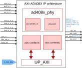

.. _axi_ad408x:

AXI AD408X
================================================================================

.. hdl-component-diagram::

The :git-hdl:`AXI AD408X <library/axi_ad408x>` IP core can be used to interface
the :adi:`AD4080` device.
This documentation only covers the IP core and requires one to be
familiar with the device, for a complete and better understanding.

More about the generic framework interfacing ADCs can be read in :ref:`axi_adc`.

Features
--------------------------------------------------------------------------------

* AXI Lite control/status interface
* Programmable line delays
* DDR data stream selection
* Single/dual lane data stream selection
* Bit-slip capability for synchronization
* Filtered data support
* Programmable decimation rate support
* Xilinx devices compatible

Files
--------------------------------------------------------------------------------

.. list-table::
   :header-rows: 1

   * - Name
     - Description
   * - :git-hdl:`library/axi_ad408x/axi_ad408x.v`
     - Verilog source for the AXI AD408X.
   * - :git-hdl:`library/axi_ad408x/ad408x_phy.v`
     - Verilog source for the AXI AD408X physical interface.
   * - :git-hdl:`library/axi_ad408x/axi_ad408x_ip.tcl`
     - IP definition file (AMD tools)

Block Diagram
--------------------------------------------------------------------------------

Configuration Parameters
--------------------------------------------------------------------------------

.. hdl-parameters::

   * - ID
     - Core ID should be unique for each IP in the system
   * - FPGA_TECHNOLOGY
     - Used to select between FPGA devices, auto set in project.
   * - NUM_LANES
     - Number of LVDS data lanes the interface is built for (default: 2).
       A single lane build does not generate the dual lane datapaths. A two
       lane build also runs a converter set to one lane: the driver selects
       the lane mode at run time through the NUM_LANES field of CNTRL, and
       the reset value selects one lane.
   * - ENABLE_20BIT
     - Build the 20-bit converter datapath (default: 1).
   * - ENABLE_16BIT
     - Build the 16-bit converter datapath (default: 1).
   * - ENABLE_14BIT
     - Build the 14-bit converter datapath (default: 1).
   * - EN_FILTER_RDY
     - 1 (default): filter_rdy_n is deserialized beside the data, bit accurate.
       It must come straight from a pin in the I/O bank of the data clock.
       0: no filter support, filter_rdy_n is unused and FILTER_ENABLE has no
       effect. Use this when the line is not such a pin, comes through an IOBUF
       or is not connected.
   * - ADC_DATA_WIDTH
     - Derived, do not override. Width of the adc_data bus, and therefore the
       required DMA source width: 32 when ENABLE_20BIT is set, or when
       ENABLE_14BIT is set on two lanes, 16 otherwise. On the 32-bit bus a 20-bit sample is sign extended to 32 bits,
       while the 16-bit and 14-bit depths carry two samples per word, each sign
       extended to its own 16-bit half, the earlier sample in [15:0]. The memory
       then holds 16-bit samples in time order, exactly as with one sample per
       beat on a 16-bit bus. Only the logic of the enabled bit depths is
       generated, and at least one of ENABLE_20BIT, ENABLE_16BIT or ENABLE_14BIT
       must be set.

Interface
--------------------------------------------------------------------------------

.. hdl-interfaces::

   * - filter_rdy_n
     - Signals when the filtered data is ready at the interface
   * - sync_n
     - Signals when the clock is disabled and the design should be in reset
   * - cnv_in_p
     - LVDS input positive side of differential CNV signal
   * - cnv_in_n
     - LVDS input negative side of differential CNV signal
   * - dclk_in_p
     - LVDS input positive side of differential reference clock signal
   * - dclk_in_n
     - LVDS input negative side of differential reference clock signal
   * - data_a_in_p
     - LVDS input positive side of differential data line A signal
   * - data_a_in_n
     - LVDS input negative side of differential data line A signal
   * - data_b_in_p
     - LVDS input positive side of differential data line B signal
   * - data_b_in_n
     - LVDS input negative side of differential data line B signal
   * - delay_clk
     - Delay clock input for IO_DELAY control, 200 MHz (7 series) or 300 MHz
       (Ultrascale)
   * - adc_clk
     - The clock used to shift data out of the IP
   * - adc_valid
     - Indicates valid data
   * - adc_data
     - Received data output
   * - adc_dovf
     - Data overflow. Must be connected to the DMA
   * - s_axi
     - Standard AXI Slave Memory Map interface

Internal Interface Description
~~~~~~~~~~~~~~~~~~~~~~~~~~~~~~~~~~~~~~~~~~~~~~~~~~~~~~~~~~~~~~~~~~~~~~~~~~~~~~~

The axi_ad408x operates as follows:

* The LVDS data lanes are deserialized by an
  :git-hdl:`ad_serdes_in<library/xilinx/common/ad_serdes_in.v>` instance, and
  the single ended filter_rdy_n line by a second one on the same clocks, so
  the filter level arrives bit for bit beside the data. Every lane uses a 1:8
  ratio on a clock divided by 4, so the fabric receives an 8-bit word per
  cycle on a single lane and a 16-bit word on two lanes. A dual lane build
  with the converter set to one lane joins two lane A words into one 16-bit
  word.
* The fabric word is bit aligned before packing by
  :git-hdl:`ad_bitslip_align<library/common/ad_bitslip_align.v>`: the offset
  found by the pattern search is selected from a short delay line of words and
  takes effect with the next word, so the samples leave the packer on fixed
  bit positions.
* The aligned words are sent to the
  :git-hdl:`ad_pack<library/common/ad_pack.v>` module, which packs them into a
  20/16/14-bit sample based on the DEVICE_CODE field of the 0x4C (ADC Common)
  register. The 14-bit packer of a dual lane build emits two samples at a time,
  since 16 bits per cycle can hold more than one 14-bit sample; every other
  packer emits one.
* The filter gives every sample its own keep bit, in
  :git-hdl:`ad_sample_edge_select<library/common/ad_sample_edge_select.v>`,
  without added latency. On the
  32-bit bus the kept 16-bit and 14-bit samples are paired by
  :git-hdl:`ad_sample_compact<library/common/ad_sample_compact.v>`, which
  closes the gaps left by dropped samples, so a word always carries two
  consecutive kept samples.
* When the bit-slip (synchronization process) is enabled, the software
  configures the ADC to output a fixed pattern, and the interface module will
  adjust the data alignment until the pattern is captured. Only valid samples
  are compared, and only once the samples of a changed offset have reached the
  comparison.
* When the filter is enabled, exactly one sample per decimation period is
  validated: the first output of a new filter result, where the Filter Result
  Ready (active low) level, taken in the middle of each sample, falls. The
  converter repeats the result for the rest of the period. With the
  EN_FILTER_RDY parameter set the line is deserialized beside the data and
  must come from a pin in the I/O bank of the data clock; with it cleared there
  is no filter support and FILTER_ENABLE has no effect.

Register Map
--------------------------------------------------------------------------------

The register map of the core contains instances of several generic register maps
like ADC common, ADC channel,
:git-hdl:`up_delay_cntrl <library/common/up_delay_cntrl.v>`.
The following table presents the base addresses of each instance, after it you
can find the detailed description of each generic register map.

The absolute address of a register should be calculated by adding the instance
base address to the registers relative address. For a more detailed explanation,
see :ref:`ADC register access <generic-adc-register-access>`.

.. list-table:: Register Map base addresses for axi_ad408x
   :header-rows: 1

   * - HDL reg
     - Software reg
     - Name
     - Description
   * - 0x0000
     - 0x0000
     - BASE
     - See the `Base <#hdl-regmap-COMMON>`__ table for more details.
   * - 0x0000
     - 0x0000
     - RX COMMON
     - See the `ADC Common <#hdl-regmap-ADC_COMMON>`__ table for more details.
   * - 0x0000
     - 0x0000
     - RX CHANNELS
     - See the `ADC Channel <#hdl-regmap-ADC_CHANNEL>`__ table for more details.
   * - 0x0000
     - 0x0800
     - IO_DELAY_CNTRL
     - See the `I/O Delay Control <#hdl-regmap-IO_DELAY_CNTRL>`__ table for more details.

.. hdl-regmap::
   :name: COMMON
   :no-type-info:

.. hdl-regmap::
   :name: ADC_COMMON
   :no-type-info:

.. hdl-regmap::
   :name: ADC_CHANNEL
   :no-type-info:

.. hdl-regmap::
   :name: IO_DELAY_CNTRL
   :no-type-info:

Design Guidelines
--------------------------------------------------------------------------------

The control of the AD408X chip is done through a SPI interface, which is needed
at system level.

The *ADC interface signals* must be connected directly to the top file of the
design, as I/O primitives are part of the IP.

The example design uses a DMA to move the data from the output of the IP to
memory.

If the data needs to be processed in HDL before moving it to the memory, it can be
done at the output of the IP (at system level) or inside of the ADC channel
module (at IP level).

The example design uses a processor to program all the registers. If no
processor is available in your system, you can create your own IP starting from
the interface module.

Software Guidelines
--------------------------------------------------------------------------------

.. list-table:: Main registers used to control the AXI AD408X IP
   :header-rows: 1

   * - Name
     - Register
     - BIT
     - Description
   * - SYNC *
     - 0x44 (ADC Common)
     - 3
     - This bit enables capture synchronization. When activated, it initiates
       an HDL process that aligns the sample's most significant bit (MSB) based
       solely on the captured data, without considering the AD408X device's CNV signal.
       This bit is self-clearing and should be toggled whenever synchronization
       is needed (e.g., at boot or after updating the sampling rate).
   * - NUM_LANES *
     - 0x44 (ADC Common)
     - [12:8]
     - This field specifies the number of data lanes utilized for data transfer,
       which can be either 1 or 2.
   * - FILTER_ENABLE
     - 0x4C (ADC Common)
     - 0
     - Setting this bit configures the sample capture to occur at each falling
       edge of the Filter Result Ready pin of the AD408X devices, as opposed to
       continuous mode when the digital filter feature is disabled.
   * - DEVICE_CODE
     - 0x4C (ADC Common)
     - [3:2]
     - Resolution selection code for the LVDS DATA deserialization
       (00: 20-bit, 01: 16-bit, 10: 14-bit).
       Only the bit depths enabled at build time through ENABLE_20BIT,
       ENABLE_16BIT and ENABLE_14BIT are available. When exactly one depth is
       built the selection is a constant and this field has no effect, so any
       value the driver writes still yields correct operation.
   * - SYNC_STATUS *
     - 0x68 (ADC Common)
     - 0
     - This bit indicates whether the sample's MSB alignment has been correctly
       performed and the capture is synchronized. If successful, this bit will
       be set to 1.

.. note::

  \* The register already exist in ADC Common. This is just a detailed explanation.

Software Suppport
--------------------------------------------------------------------------------
* Linux support at :git-linux:`/`

References
-------------------------------------------------------------------------------

* HDL IP core at :git-hdl:`library/axi_ad408x`
* HDL project at :git-hdl:`projects/ad4080_fmc_evb`
* HDL project documentation at :ref:`ad4080_fmc_evb`
* :adi:`AD4080`
* :xilinx:`Zynq-7000 SoC Overview <support/documentation/data_sheets/ds190-Zynq-7000-Overview.pdf>`
* :xilinx:`Zynq-7000 SoC Packaging and Pinout <support/documentation/user_guides/ug865-Zynq-7000-Pkg-Pinout.pdf>`
