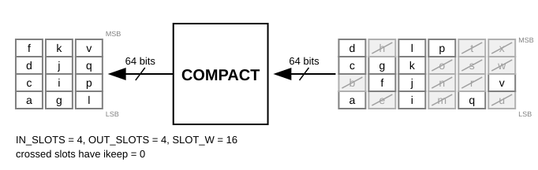
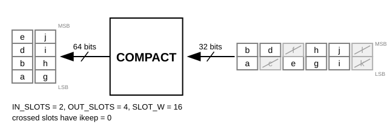

.. _util_sample_compact:

Sample Compact
===============================================================================

.. hdl-component-diagram::

The :git-hdl:`Sample Compact <library/util_sample_compact>` core collects the
kept slots of its input in arrival order and sends every OUT_SLOTS of them as
one output word. Dropped slots leave no gap in the output stream.

Features
-------------------------------------------------------------------------------

* Supports AMD Xilinx devices
* Configurable slot width and slots per input and output word
* Automatic or manual pipeline registers

Files
-------------------------------------------------------------------------------

.. list-table::
   :header-rows: 1

   * - Name
     - Description
   * - :git-hdl:`library/util_sample_compact/util_sample_compact.v`
     - Verilog wrapper.
   * - :git-hdl:`library/common/ad_sample_compact.v`
     - Slot compactor.

Configuration Parameters
-------------------------------------------------------------------------------

.. hdl-parameters::

   * - SLOT_W
     - Width of one slot in bits.
   * - IN_SLOTS
     - Slots per input word.
   * - OUT_SLOTS
     - Slots per output word; IN_SLOTS <= OUT_SLOTS keeps the buffer from
       overflowing.
   * - ASYNC_RESET
     - Reset the write pointer and ovalid asynchronously.
   * - ROT_IMPL
     - Rotation into the word buffer: 0 automatic, 1 multiplexer, 2 barrel.
   * - PIPE_STAGES, LEVEL_BUDGET, PIPE_MASK
     - Pipeline registers; PIPE_STAGES = -1 (default) places them
       automatically.

Interface
-------------------------------------------------------------------------------

.. hdl-interfaces::

   * - idata, ikeep
     - Input slots, slot 0 the earliest in the low bits, and one keep bit per
       slot.
   * - odata, ovalid
     - Output word of OUT_SLOTS slots, valid in the cycle ovalid is set.

Detailed Description
-------------------------------------------------------------------------------

The kept slots leave in arrival order, OUT_SLOTS per odata word, with no gap
for the dropped ones. Words are drawn as columns, the least significant slot
at the bottom, in time order from left to right; crossed slots have ikeep = 0.

   IN_SLOTS = 4, OUT_SLOTS = 4: 64-bit idata and odata words

   IN_SLOTS = 2, OUT_SLOTS = 4: 32-bit idata words, 64-bit odata words

There is no backpressure. A sample wider than one slot occupies several slots
that are kept together. Slots that do not fill a whole output word stay in
the buffer until reset.

References
-------------------------------------------------------------------------------

* HDL IP core at :git-hdl:`library/util_sample_compact`
