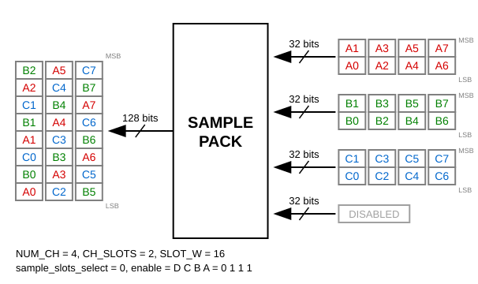
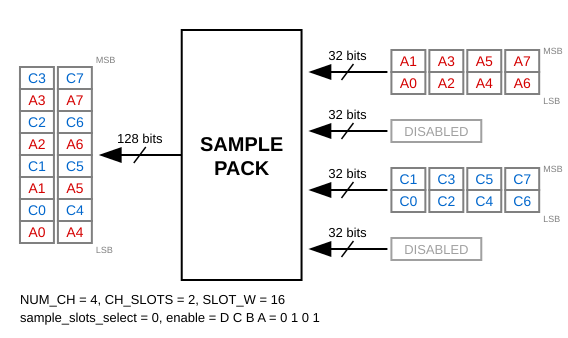
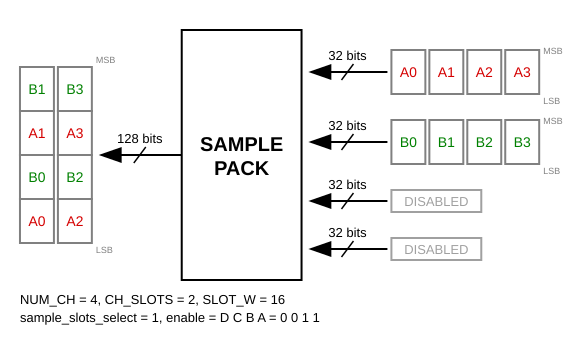
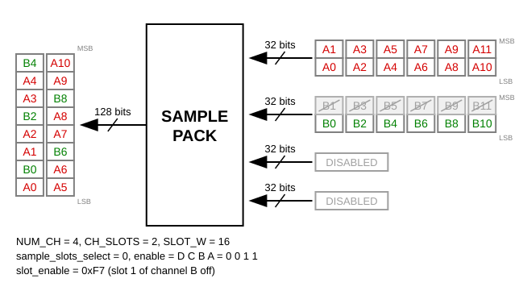
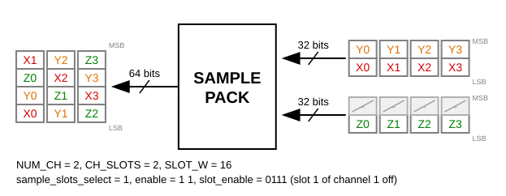
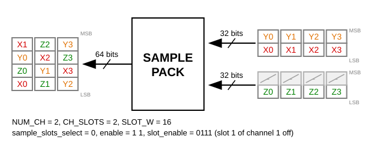

.. _util_sample_pack:

Sample Pack
===============================================================================

.. hdl-component-diagram::

The :git-hdl:`Sample Pack <library/util_sample_pack>` core, like
:ref:`util_cpack2`, allows one or more channels to be enabled by software
without any padding, so the DMA bandwidth is fully used. The ADC interface is
channel based (one interface per ADC channel) and consists of enable, valid
and data signals. The DMA interface is a single FIFO interface. The core packs
the samples of the enabled channels into one data bus, in time order.

In addition to util_cpack2, the sample size can change at run time, single
slots of a channel can be dropped, and an optional join FIFO first brings
channels that deliver on their own clocks onto one clock.

Features
-------------------------------------------------------------------------------

* Supports AMD Xilinx devices
* Up to 64 channels
* Configurable slot width (SLOT_W) and slots per channel word (CH_SLOTS)
* Sample size selected at run time, as the log2 of the slots per sample
  (sample_slots_select)
* Optional per slot enable (slot_enable)
* Channels and slots kept on by parameter (ALWAYS_ENABLE_MASK,
  ALWAYS_SLOT_ENABLE_MASK), so their enables need not be connected
* Optional join FIFO for channels on separate clocks from one reference
* Optional synchronization of the configuration, and hold of it during a
  transfer

Files
-------------------------------------------------------------------------------

.. list-table::
   :header-rows: 1

   * - Name
     - Description
   * - :git-hdl:`library/util_sample_pack/util_sample_pack.v`
     - Verilog wrapper with separate ports per channel.
   * - :git-hdl:`library/common/ad_sample_pack.v`
     - Packer.
   * - :git-hdl:`library/common/ad_sample_join_fifo.v`
     - Join FIFO, used with JOIN_FIFO_ENABLE.
   * - :git-hdl:`library/util_sample_pack/util_sample_pack_constr.ttcl`
     - Clock domain crossing constraints.

Configuration Parameters
-------------------------------------------------------------------------------

.. hdl-parameters::

   * - SLOT_W
     - Width of one slot in bits.
   * - NUM_CH
     - Number of channels, a power of two.
   * - CH_SLOTS
     - Slots in the data word of each channel, a power of two.
   * - ENABLE_SAMPLE_SLOTS_SELECT
     - Use sample_slots_select: a sample takes 2**sample_slots_select slots;
       otherwise a sample is one slot.
   * - CONFIG_CDC
     - Synchronize enable_i, sample_slots_select and slot_enable to clk.
       Always on with JOIN_FIFO_ENABLE.
   * - SAMPLE_SLOTS_SELECT_WIDTH
     - Width of sample_slots_select, derived from CH_SLOTS: 1 bit up to 2
       slots, 2 bits up to 8, 3 bits up to 128.
   * - SLOT_ENABLE
     - Split the channel enables into slots with slot_enable.
   * - ALWAYS_ENABLE_MASK
     - Bit c set keeps channel c enabled whatever enable_c says. Default 0.
   * - ALWAYS_SLOT_ENABLE_MASK
     - With SLOT_ENABLE, bit c*CH_SLOTS + s set keeps slot s of channel c
       enabled whatever slot_enable says. Default 0.
   * - PIPE_STAGES, LEVEL_BUDGET, PIPE_MASK
     - Pipeline registers of the packing network; PIPE_STAGES = -1 (default)
       places them automatically.
   * - JOIN_FIFO_ENABLE
     - Each channel delivers on its own clk_i; the join FIFO pairs the n-th
       words of all channels onto clk.
   * - JOIN_FIFO_ADDRESS_WIDTH
     - Address width of the FIFO of each channel in the join FIFO.
   * - XFER_REQ_ENABLE
     - Hold the packer while packed_fifo_wr_xfer_req is low, so a capture
       starts with the words after the request.
   * - OVERFLOW_XFER_REQ
     - Report a word dropped by a full join FIFO only while
       packed_fifo_wr_xfer_req is high.
   * - CONFIG_XFER_HOLD
     - Keep enable_i, sample_slots_select and slot_enable while
       packed_fifo_wr_xfer_req is high, so one buffer never mixes layouts.

Interface
-------------------------------------------------------------------------------

.. hdl-interfaces::

   * - packed_fifo_wr
     - FIFO interface to the DMA. Its data width is NUM_CH * CH_SLOTS * SLOT_W
       bits.
   * - valid_i
     - Indicates that data_i is valid. Without JOIN_FIFO_ENABLE all channels
       are on clk and valid_0 qualifies all of them.
   * - enable_i
     - Indicates the status of channel i; if asserted the channel is active.
       Unconnected, it reads as 0; set the channel in ALWAYS_ENABLE_MASK to
       keep it on without a connection.
   * - data_i
     - ADC data bus of channel i, CH_SLOTS slots, slot 0 the earliest in the
       low bits.
   * - clk_i, reset_i
     - Clock and reset of channel i, with JOIN_FIFO_ENABLE only.
   * - overflow_i
     - Overflow of the DMA, and with JOIN_FIFO_ENABLE a word dropped by a
       full join FIFO.
   * - async_resetn
     - Asynchronous reset of the join FIFO, e.g. the sync_n of the
       converters.
   * - sample_slots_select
     - log2 of the slots per sample, with ENABLE_SAMPLE_SLOTS_SELECT: 0 for
       one slot, 1 for two slots, and so on up to log2(CH_SLOTS); a larger
       value gives no output. SAMPLE_SLOTS_SELECT_WIDTH bits, derived from
       CH_SLOTS. Unconnected, it reads as 0.
   * - slot_enable
     - Bit c*CH_SLOTS + s enables slot s of channel c, together with
       enable_c; with SLOT_ENABLE. Unconnected, it reads as 0.

Detailed Description
-------------------------------------------------------------------------------

Every valid cycle each channel delivers CH_SLOTS slots. Two things decide the
output:

* Which slots are kept. Slot s of channel c is kept when enable_c is set and,
  with SLOT_ENABLE, bit c*CH_SLOTS + s of slot_enable is set as well; without
  SLOT_ENABLE every slot of an enabled channel is kept. A bit set in
  ALWAYS_ENABLE_MASK or ALWAYS_SLOT_ENABLE_MASK counts as an enable that is
  always set. With two slots per sample (sample_slots_select = 1), for
  example, a 32-bit channel word can carry two 16-bit signals, and
  slot_enable passes one or both of them.
* How many slots form a sample: 2**sample_slots_select, with
  ENABLE_SAMPLE_SLOTS_SELECT; otherwise one. The kept slots of a sample
  leave next to each other.

The output words hold sample r of every channel, channel by channel, then
sample r + 1. A slot that is not kept leaves no gap.

Unless noted otherwise, the examples use NUM_CH = 4, CH_SLOTS = 2 and
SLOT_W = 16: each channel delivers a 32-bit data_i word per valid cycle, and
the packed_fifo_wr data is 128 bits wide. Words are drawn as columns, the
least significant slot at the bottom, in time order from left to right.

   16-bit samples (sample_slots_select = 0), three channels enabled; the same
   result as util_cpack2

   16-bit samples (sample_slots_select = 0), channels A and C enabled

   32-bit samples (sample_slots_select = 1) on the same hardware, channels A
   and B enabled; each sample takes two slots

   16-bit samples (sample_slots_select = 0), channels A and B enabled;
   slot_enable bit 3 = 0 drops slot 1 of channel B

   NUM_CH = 2, sample_slots_select = 1: data_0 carries the 16-bit signals X
   and Y, data_1 carries Z in slot 0; slot_enable bit 3 = 0 drops slot 1 of
   channel 1, so every cycle X Y Z leave as three 16-bit slots

   The same inputs with sample_slots_select = 0: the slots leave in the order
   X Z Y

A change of enable_i, sample_slots_select or slot_enable refills the routing
table of the packer, and the input is dropped for N * (N + 2) + 3 clk cycles,
where N = NUM_CH * CH_SLOTS.

The join FIFO requires the channel clocks to come from the same reference at
the same frequency; they may start at different times. Clocks from independent
references drift apart, and words are lost now and then.

References
-------------------------------------------------------------------------------

* HDL IP core at :git-hdl:`library/util_sample_pack`
* :ref:`util_cpack2`
* :ref:`util_sample_join_fifo`
