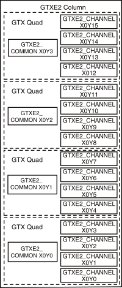
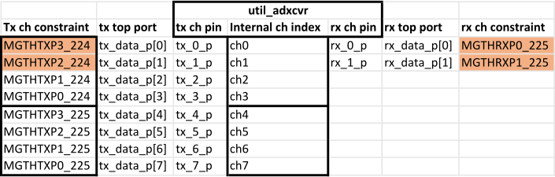
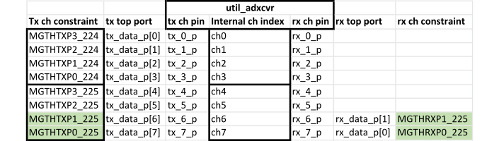
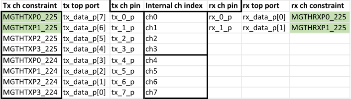

.. _util_adxcvr:

UTIL_ADXCVR core for AMD Xilinx devices
================================================================================

.. hdl-component-diagram::
   :path: library/xilinx/util_adxcvr

The
:git-hdl:`util_adxcvr <library/xilinx/util_adxcvr>`
IP core instantiates a Gigabit Transceiver (GT) and sets up the required
configuration. Basically, it is a simple wrapper file for a GT\* Column,
exposing just the necessary ports and attributes.

.. note::
    To understand the below wiki page is important to have a basic
    understanding about High Speed Serial I/O interfaces and Gigabit Serial
    Transceivers. To find more information about these technologies, please visit
    the :xilinx:`AMD Xilinx's solution center <support/answers/37181.html>`.

Currently this IP supports the following GT types:

-  GTXE2
   (:xilinx:`7 Series devices <support/documentation/user_guides/ug476_7Series_Transceivers.pdf>`)
-  GTHE3
   (:xilinx:`Ultrascale and Ultrascale+ <support/documentation/user_guides/ug576-ultrascale-gth-transceivers.pdf>`)
-  GTHE4
   (:xilinx:`Ultrascale and Ultrascale+ <support/documentation/user_guides/ug576-ultrascale-gth-transceivers.pdf>`)
-  GTYE4
   (:xilinx:`Ultrascale and Ultrascale+ <support/documentation/user_guides/ug578-ultrascale-gty-transceivers.pdf>`)
-  GTYE5 and GTYP
   (`Versal <https://docs.amd.com/r/en-US/am002-versal-gty-transceivers>`__)
   and GTME5 (`Versal <https://docs.amd.com/r/en-US/am017-versal-gtm-transceivers>`__,
   NRZ), see :ref:`util_adxcvr versal`

Features
--------------------------------------------------------------------------------

*  Supports GTX2, GTH3 and GTH4
*  Exposes all the necessary attributes for QPLL/CPLL configuration
*  Supports shared transceiver mode
*  Supports dynamic reconfiguration
*  RX Eye Scan
*  Versal GTY, GTYP and GTM quads, configured from a Versal Transceivers Wizard
   run

Block Diagram
--------------------------------------------------------------------------------

The following diagram shows a GTXE2 Column, which contains four GT Quads. Each
quad contains a GTEX2_COMMON and four GTXE2_CHANNEL primitives.

Configuration Parameters
--------------------------------------------------------------------------------

.. hdl-parameters::

  * - XCVR_TYPE
    - | Define the current GT type:
      | GTXE2(2), GTHE3(5), GTHE4(8), GTYE4(9), GTYE5(11), GTYP(12), GTME5(13)
  * - LINK_MODE
    - Encoding: 1 for 8B/10B (JESD204B), 2 for 64B/66B (JESD204C)
  * - RX_LANE_RATES
    - Versal: up to eight RX lane rates [Gb/s]; the first is rate 0. Empty:
      RX_LANE_RATE only
  * - TX_LANE_RATES
    - Versal: as RX_LANE_RATES, for TX
  * - REF_CLK_RATE
    - Versal: reference clock [MHz], shared by all lane rates
  * - EXTERNAL_LINK_CLK
    - Versal GTM 64B/66B: link clock from ``link_refclk`` (0) or from
      ``rx/tx_link_clk_in`` (1)
  * - PLL_RST_SEL
    - Versal, set by ``ad_xcvrcon``: the quad PLLs are reset by the QPLL
      owner (0) or by the CPLL reset (1)
  * - NON_CONSECUTIVE_QUADS
    - Versal: configure each quad on its own (1), so the quads can be in any
      order, instead of as one chain (0)
  * - Q0_RX_LANES
    - Versal, set by the project scripts: RX lanes used in quad 0 (-1: from
      RX_NUM_OF_LANES); Q1-Q7_RX_LANES likewise
  * - Q0_TX_LANES
    - Versal: as Q0_RX_LANES, for TX
  * - QA_ATTRS
    - Versal, set by the project scripts: packed attributes shared by all
      quads, see :ref:`util_adxcvr versal`
  * - Q0_ATTRS
    - Versal, set by the project scripts: packed attributes of quad 0;
      Q1-Q7_ATTRS likewise
  * - QPLL_REFCLK_DIV
    - QPLL reference clock divider M, see User Guide for more info
  * - QPLL_FBDIV_RATIO
    - QPLL reference clock divider N ratio, see User Guide for more info
  * - QPLL_CFG
    - Configuration settings for QPLL, see User Guide for more info
  * - QPLL_FBDIV
    - QPLL reference clock divider N, see User Guide for more info
  * - CPLL_FBDIV
    - CPLL feedback divider N2 settings, see User Guide for more info
  * - CPLL_FBDIV_4_5
    - CPLL reference clock divider N1 settings, see User Guide for more info
  * - TX_NUM_OF_LANES
    - Number of transmit lanes.
  * - TX_OUT_DIV
    - CPLL/QPLL output clock divider D for the TX datapath, see User Guide for
      more info
  * - TX_CLK25_DIV
    - Divider for internal 25 MHz clock for the TX datapath, see User Guide
      for more info
  * - TX_LANE_INVERT
    - Per lane polarity inversion. Set the n-th bit to invert the polarity of
      the n-th transmit lane.
  * - RX_NUM_OF_LANES
    - Number of transmit lanes
  * - RX_OUT_DIV
    - CPLL/QPLL output clock divider D for the RX datapath, see User Guide for
      more info
  * - RX_CLK25_DIV
    - Divider for internal 25 MHz clock for the RX datapath, see User Guide
      for more info
  * - RX_DFE_LPM_CFG
    - Configure the GT use modes, LPM or DFE, see User Guide for more info
  * - RX_PMA_CFG
    - Search for PMA_RSV in User Guide for more info
  * - RX_CDR_CFG
    - Configure the RX clock data recovery circuit for GTXE2, see User Guide
      for more info
  * - RX_LANE_INVERT
    - Per lane polarity inversion. Set the n-th bit to invert the polarity of
      the n-th receive lane.

Interface
--------------------------------------------------------------------------------

Microprocessor clock and reset
^^^^^^^^^^^^^^^^^^^^^^^^^^^^^^^^^^^^^^^^^^^^^^^^^^^^^^^^^^^^^^^^^^^^^^^^^^^^^^^^

.. list-table::
   :header-rows: 1

   * - Pin
     - Type
     - Description
   * - ``up_clk``
     - ``input``
     - System clock, running on 100 MHz
   * - ``up_rstn``
     - ``input``
     - System reset, the same as AXI memory map subordinate interface reset

PLL reference clock
^^^^^^^^^^^^^^^^^^^^^^^^^^^^^^^^^^^^^^^^^^^^^^^^^^^^^^^^^^^^^^^^^^^^^^^^^^^^^^^^

.. list-table::
   :header-rows: 1

   * - Pin
     - Type
     - Description
   * - ``qpll_ref_clk_0``
     - ``input``
     - Reference clock for the QPLL
   * - ``cpll_ref_clk_0``
     - ``input``
     - Reference clock for the CPLL

RX interface
^^^^^^^^^^^^^^^^^^^^^^^^^^^^^^^^^^^^^^^^^^^^^^^^^^^^^^^^^^^^^^^^^^^^^^^^^^^^^^^^

.. list-table::
   :header-rows: 1

   * - Pin
     - Type
     - Description
   * - ``rx_*_p``
     - ``input``
     - Positive differential serial data input
   * - ``rx_*_n``
     - ``input``
     - Negative differential serial data input
   * - ``rx_out_clk_*``
     - ``output``
     - Core logic clock output. Frequency = serial line rate/40
   * - ``rx_clk_*``
     - ``input``
     - Core logic clock loop-back input
   * - ``rx_charisk_*``
     - ``output[3:0]``
     - RX Char is K to the JESD204B IP
   * - ``rx_disperr_*``
     - ``output[3:0]``
     - RX disparity error to the JESD204B IP
   * - ``rx_notintable_*``
     - ``output[3:0]``
     - RX Not In Table to the JESD204B IP
   * - ``rx_data_*``
     - ``output[3:0]``
     - RX data to the JESD204B IP
   * - ``rx_calign_*``
     - ``input``
     - RX enable comma alignment from the JESD204B IP

TX interface
^^^^^^^^^^^^^^^^^^^^^^^^^^^^^^^^^^^^^^^^^^^^^^^^^^^^^^^^^^^^^^^^^^^^^^^^^^^^^^^^

.. list-table::
   :header-rows: 1

   * - Pin
     - Type
     - Description
   * - ``tx_*_p``
     - ``output``
     - Positive differential serial output
   * - ``tx_*_n``
     - ``output``
     - Negative differential serial output
   * - ``tx_out_clk_*``
     - ``output``
     - Core logic clock output. Frequency = serial line rate/40
   * - ``tx_clk_*``
     - ``input``
     - Core logic clock loop-back input
   * - ``tx_charisk_*``
     - ``input[3:0]``
     - TX Char is K from the JESD204B IP
   * - ``tx_data_*``
     - ``input[31:0]``
     - TX data from the JESD204B IP

Common DRP Interface
^^^^^^^^^^^^^^^^^^^^^^^^^^^^^^^^^^^^^^^^^^^^^^^^^^^^^^^^^^^^^^^^^^^^^^^^^^^^^^^^

.. list-table::
   :header-rows: 1

   * - Pin
     - Type
     - Description
   * - ``up_cm_*``
     - ``IO``
     - The common DRP interface, must be connected to the equivalent DRP ports
       of AXI_ADXCVR. This is a QUAD interface, shared by four transceiver
       lanes. This interface is available only if parameter QPLL_ENABLE is set
       to 0x1.

Channel DRP Interface
^^^^^^^^^^^^^^^^^^^^^^^^^^^^^^^^^^^^^^^^^^^^^^^^^^^^^^^^^^^^^^^^^^^^^^^^^^^^^^^^

.. list-table::
   :header-rows: 1

   * - Pin
     - Type
     - Description
   * - ``up_rx_*``
     - ``IO``
     - The RX channel DRP interface, must be connected to the equivalent DRP ports
       of AXI_ADXCVR. This is a channel interface, one per each RX transceiver
       lane.
   * - ``up_tx_*``
     - ``IO``
     - The TX channel DRP interface, must be connected to the equivalent DRP ports
       of AXI_ADXCVR. This is a channel interface, one per each TX transceiver
       lane.

Eye Scan DRP Interface
^^^^^^^^^^^^^^^^^^^^^^^^^^^^^^^^^^^^^^^^^^^^^^^^^^^^^^^^^^^^^^^^^^^^^^^^^^^^^^^^

.. list-table::
   :header-rows: 1

   * - Pin
     - Type
     - Description
   * - ``up_es_*``
     - ``IO``
     - The Eye-Scan DRP interface, must be connected to the equivalent DRP
       ports of UTIL_ADXCVR. This is a channel interface, one per each
       transceiver lane. This interface is available only if parameter
       TX_OR_RX_N is set to 0x0.

.. _util_adxcvr versal:

Versal devices
--------------------------------------------------------------------------------

On Versal the core instantiates the quad primitives itself (``GTYE5_QUAD``,
``GTYP_QUAD`` or ``GTME5_QUAD``, one per four lanes), together with the AMD
reset, rate-change and register-bridge helpers and the Link-to-Phy adapters.
The block design has no Transceivers Wizard and no
``jesd204_versal_gt_adapter_rx/tx``; the project connects the core with
``ad_xcvrcon`` as on the other devices.

The quad attributes depend on the lane rates and the reference clock. After
``system_bd.tcl`` the project scripts run the Wizard in a separate Vivado
process, cache the result in ``<project>/versal_xcvr/<util_adxcvr>`` and set
it on the core: QA_ATTRS holds the attributes shared by all quads, Q<n>_ATTRS
those of quad n and QUAD<n>_MEM_FILE its firmware image. Bit-vector attributes
are packed one per 32-bit slot, as ``util_adxcvr_quad_versal.v`` slices them
(e.g. ``.A_CFG0 (QA_ATTRS[0*32 +: 32])``); string and real attributes are
separate parameters (QA_<name>, Q<n>_<name>).
``versal_xcvr_unpack <cell>`` returns all of them as a dict.

*  One reset controller per direction resets all the quads of the core. Links
   that must reset independently need one util_adxcvr each.
*  Lane n uses the slot (quad * 4 + channel) given by the ``ad_xcvrcon`` lane
   map; the used channels of a quad must start at channel 0. The quads are
   configured as one chain, unless NON_CONSECUTIVE_QUADS is 1 or the lanes per
   quad differ from the Wizard's packing.
*  XCVR_TYPE is taken from the part. Parts with two GT types (e.g. GTME5 and
   GTYP) need ``TRANSCEIVER_TYPE`` set in the project.
*  Each lane rate is one line-rate configuration of the quads, selected by
   AXI_ADXCVR CONTROL.RATE. AXI_ADXCVR reaches the quad registers through
   ``up_qm_*``, one per quad (see :ref:`AXI_ADXCVR <axi_adxcvr versal>`).
*  The scripts stop with an error if the Wizard output does not fit the core:
   a value wider than its attribute, or a setting the helpers compute
   themselves (e.g. GTM ``UB_CFG0``) that differs.
*  The helper sources in ``versal_gen/`` are generated from the Wizard when
   the library is built.

GTM runs NRZ only and has no LPM/DFE, eye-scan or TX swing control. In
64B/66B its GT runs at lane rate / 64 and the link at lane rate / 66, so the
reference clock must be lane rate / 66, with its ``IBUFDS_GTME5`` ``ODIV2``
output (divide by 1) on ``link_refclk``; with EXTERNAL_LINK_CLK = 1 the link
clocks come from ``rx/tx_link_clk_in`` instead.

.. list-table:: Encoding matrix
   :header-rows: 1

   * -
     - GTY/GTYP 8B/10B
     - GTY/GTYP 64B/66B
     - GTM 8B/10B
     - GTM 64B/66B
   * - GT encoding
     - 8B/10B, 32-bit
     - 64B/66B gearbox, 64-bit
     - raw 40-bit, soft 8B/10B
     - raw 64-bit, soft gearbox
   * - Link clock
     - lane rate / 40
     - lane rate / 66
     - lane rate / 40
     - lane rate / 66, ``link_refclk``
   * - Multiple lane rates
     - yes
     - yes
     - yes
     - no

Design Guidelines
--------------------------------------------------------------------------------

.. note::
  Please refer to :ref:`Xilinx FPGAs Transceivers Wizard <xgt_wizard>`
  to generate the optimal parameters needed to configure the transceivers for
  your project.

Physical constraints considerations
--------------------------------------------------------------------------------

The util_adxcvr allocates resources/quads (channels and common) sequentially.
Meaning, if you have 8 lanes it will insert two quads, 4 channels and a common
block for each quad.

Channels within a quad are tightly coupled to the common block, the placement of
the channel resources can be permuted within a quad and is affected by the
constraint file with the restriction that rx\_<N>_p/n connect to tx\_<N>_p/n
must connect to the same channel.

Supposing we have the following pin constraints and connections to the
util_adxcvr:

So in this case we end up with a conflict during implementation:

We have to ensure that in implementation the mapping is correct either by
rearranging the Rx connections

or by rearranging the Tx connections of the util_adxcvr:

In such cases, when rearrangement is required due placement constraints,
complementary reordering is required either in the converter device (lane
crossbars) or inside the FPGA between the physical and link layer, to connect
the logical lanes with the same index on both end of the link.

Software Guidelines
--------------------------------------------------------------------------------

The software can configure this core through the :ref:`AXI_ADXCVR <axi_adxcvr>` IP
core.

References
--------------------------------------------------------------------------------

-  :xilinx:`High Speed Serial <products/technology/high-speed-serial.html>`
-  :xilinx:`7 Series FPGAs GTX/GTH Transceivers <support/documentation/user_guides/ug476_7Series_Transceivers.pdf>`
-  :xilinx:`UltraScale Architecture GTH Transceivers <support/documentation/user_guides/ug576-ultrascale-gth-transceivers.pdf>`
-  :xilinx:`UltraScale Architecture GTY Transceivers <support/documentation/user_guides/ug578-ultrascale-gty-transceivers.pdf>`
-  `Versal Adaptive SoC GTY and GTYP Transceivers Architecture Manual (AM002) <https://docs.amd.com/r/en-US/am002-versal-gty-transceivers>`__
-  `Versal Adaptive SoC GTM Transceivers Architecture Manual (AM017) <https://docs.amd.com/r/en-US/am017-versal-gtm-transceivers>`__

More Information
--------------------------------------------------------------------------------

-  :ref:`JESD204B High-Speed Serial Interface Support <jesd204>`
