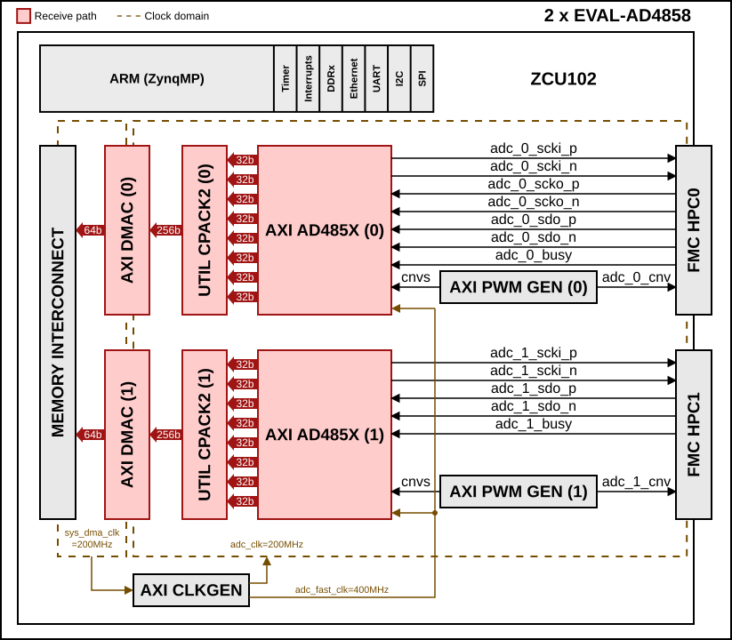
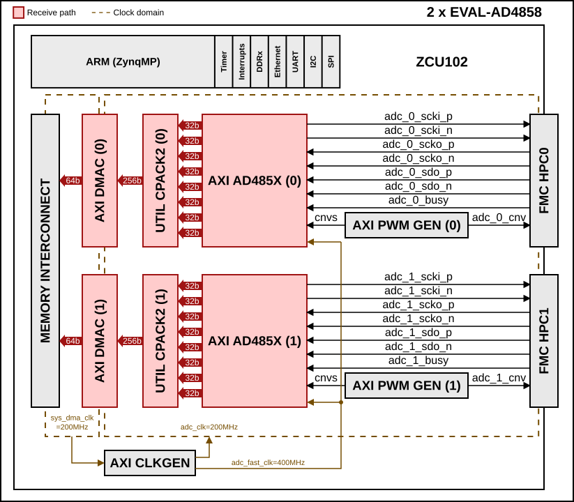
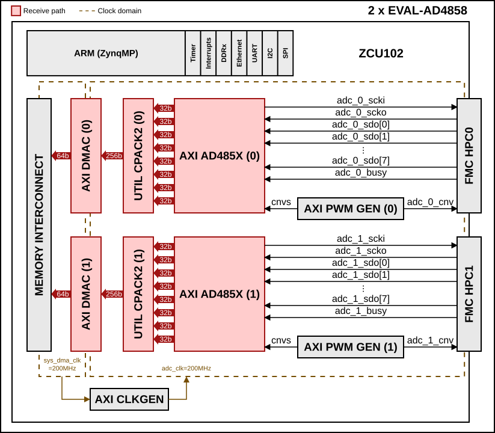
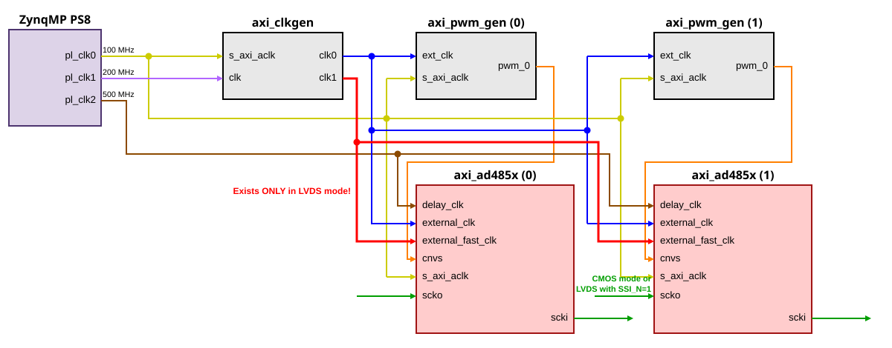

.. _ad4858_fmcz_dual:

AD4858_FMCZ_DUAL HDL project
================================================================================

This design connects two :adi:`EVAL-AD4858` boards to a single carrier, for a
total of 16 simultaneously sampled channels. Each :adi:`AD4858` is a 20-bit,
low noise 8-channel simultaneous sampling successive approximation register
(SAR) ADC, with buffered differential, wide common range picoamp inputs.

Each ADC has its own capture IP, PWM generator, CPACK and DMA, so the two
devices are controlled and read independently.

Supported boards
-------------------------------------------------------------------------------

- :adi:`EVAL-AD4858` (two boards)

Supported devices
-------------------------------------------------------------------------------

- :adi:`AD4858`

Supported carriers
-------------------------------------------------------------------------------

+--------------------+----------+------------------------+
| Evaluation board   | Carrier  | FMC slot               |
+====================+==========+========================+
| :adi:`EVAL-AD4858` | ZCU102   | FMC HPC0 (first board) |
|                    |          +------------------------+
|                    |          | FMC HPC1 (second board)|
+--------------------+----------+------------------------+

.. warning::

   Make sure the power supplies of the evaluation boards are configured as
   expected, from jumper selection. In particular, pay attention to JVIO to be
   equal to VADJ, otherwise you risk damaging the FPGA and the
   :adi:`EVAL-AD4858` boards. The project was tested in hardware with
   VADJ = 1.8 V.

Block design
-------------------------------------------------------------------------------

AD4858_FMCZ_DUAL Block diagram - LVDS interface
~~~~~~~~~~~~~~~~~~~~~~~~~~~~~~~~~~~~~~~~~~~~~~~~~~~~~~~~~~~~~~~~~~~~~~~~~~~~~~~

This is the default configuration of the project (``LVDS_CMOS_N=1``,
``SSI_N=0``). The first ADC is source-synchronous and uses the echo clock
(``adc_0_scko_p/n``). The second ADC is non-source-synchronous and has no
echo clock.

AD4858_FMCZ_DUAL Block diagram - LVDS interface, both ADCs source-synchronous
~~~~~~~~~~~~~~~~~~~~~~~~~~~~~~~~~~~~~~~~~~~~~~~~~~~~~~~~~~~~~~~~~~~~~~~~~~~~~~~

This configuration is selected with ``LVDS_CMOS_N=1`` and ``SSI_N=1``. Both
ADCs use the echo clock, so ``adc_1_scko_p/n`` is also connected.

AD4858_FMCZ_DUAL Block diagram - CMOS interface
~~~~~~~~~~~~~~~~~~~~~~~~~~~~~~~~~~~~~~~~~~~~~~~~~~~~~~~~~~~~~~~~~~~~~~~~~~~~~~~

This configuration is selected with ``LVDS_CMOS_N=0``. Both ADCs are
source-synchronous; the ``SSI_N`` parameter has no effect.

The block descriptions below apply to both diagrams.

.. collapsible:: Click here for details on the block diagram modules

   .. list-table::
      :widths: 10 20 35 35
      :header-rows: 1

      * - Block name
        - IP name
        - Documentation
        - Additional info
      * - AXI AD485X
        - :git-hdl:`axi_ad485x <library/axi_ad485x>`
        - :ref:`axi_ad485x`
        - 2 instances (``axi_ad4858_0``, ``axi_ad4858_1``), 8 channels of
          32-bit ``adc_data_[7:0]`` each, clocked by ``adc_clk``
      * - UTIL CPACK2
        - :git-hdl:`util_cpack2 <library/util_pack/util_cpack2>`
        - :ref:`util_cpack2`
        - 2 instances, each packs 8 x 32-bit samples into a 256-bit word
      * - AXI DMAC
        - :git-hdl:`axi_dmac <library/axi_dmac>`
        - :ref:`axi_dmac`
        - 2 instances (``ad4858_dma_0``, ``ad4858_dma_1``), Rx only; 256-bit
          stream source, 64-bit memory-mapped destination
      * - AXI PWM GEN
        - :git-hdl:`axi_pwm_gen <library/axi_pwm_gen>`
        - :ref:`axi_pwm_gen`
        - 2 instances, one generating ``cnvs`` (conversion start) for each ADC
      * - AXI CLKGEN
        - :git-hdl:`axi_clkgen <library/axi_clkgen>`
        - :ref:`axi_clkgen`
        - Single instance, generates ``adc_clk`` (200 MHz) and, in LVDS mode,
          ``adc_fast_clk`` (400 MHz) from ``sys_200m_clk``

Interface
~~~~~~~~~~~~~~~~~~~~~~~~~~~~~~~~~~~~~~~~~~~~~~~~~~~~~~~~~~~~~~~~~~~~~~~~~~~~~~~

The interface type is selected at build time with the ``LVDS_CMOS_N``
parameter.

- LVDS mode (default): each ADC uses a single differential data lane
  (``sdo_p/n``). The first ADC always uses the echo clock (``scko_p/n``). The
  second ADC is selected with the ``SSI_N`` parameter:

  - ``SSI_N=0`` (default): the second ADC does not use the echo clock; its
    data is captured through the NSSI path (``axi_ad4858_lvds_nssi``).
  - ``SSI_N=1``: the second ADC also uses the echo clock (``scko_p/n``), so
    both ADCs are source-synchronous.

- CMOS mode: each ADC uses 8 data lanes (``sdo[7:0]``) and the echo clock
  (``scko``).

Clock scheme
~~~~~~~~~~~~~~~~~~~~~~~~~~~~~~~~~~~~~~~~~~~~~~~~~~~~~~~~~~~~~~~~~~~~~~~~~~~~~~~

For this design, an internal clock of the FPGA is used. The external clocks
given to the two AXI_AD485x instances are generated by a single AXI_CLKGEN
from the 200 MHz ``sys_200m_clk``:

- in LVDS mode:

  - external_clk = 200 MHz
  - external_fast_clk = 400 MHz

- in CMOS mode:

  - external_clk = 200 MHz

The clocks come from ``pl_clk0`` (100 MHz), ``pl_clk1`` (200 MHz) and ``pl_clk2``
(500 MHz) of the ZynqMP PS8:

- ``pl_clk0`` drives the AXI interface of every IP.
- ``pl_clk1`` (``sys_200m_clk``) is the input clock of the AXI_CLKGEN.
- ``pl_clk2`` drives the ``delay_clk`` of the IDELAYCTRL of both AXI_AD485x
  instances.

The single AXI_CLKGEN output ``adc_clk`` is shared by both AXI_PWM_GEN and
both AXI_AD485x instances. ``adc_fast_clk`` exists only in LVDS mode. The
second ADC has an echo clock (``scko``) in CMOS mode and in LVDS mode with
``SSI_N=1``.

CPU/Memory interconnects addresses
~~~~~~~~~~~~~~~~~~~~~~~~~~~~~~~~~~~~~~~~~~~~~~~~~~~~~~~~~~~~~~~~~~~~~~~~~~~~~~~

The addresses are dependent on the architecture of the FPGA, having an offset
added to the base address from HDL (see more at :ref:`architecture cpu-intercon-addr`).

============== ===========
Instance       ZynqMP
============== ===========
axi_ad4858_0   0x43C0_0000
axi_pwm_gen_0  0x43D0_0000
ad4858_dma_0   0x43E0_0000
axi_ad4858_1   0x44C0_0000
axi_pwm_gen_1  0x44D0_0000
ad4858_dma_1   0x44E0_0000
adc_clkgen     0x4400_0000
============== ===========

SPI connections
~~~~~~~~~~~~~~~~~~~~~~~~~~~~~~~~~~~~~~~~~~~~~~~~~~~~~~~~~~~~~~~~~~~~~~~~~~~~~~~

.. list-table::
   :widths: 25 25 25 25
   :header-rows: 1

   * - SPI type
     - SPI manager instance
     - SPI subordinate
     - CS
   * - PS
     - SPI 0
     - AD4858 (first board, HPC0)
     - 0
   * - PS
     - SPI 1
     - AD4858 (second board, HPC1)
     - 0

Interrupts
~~~~~~~~~~~~~~~~~~~~~~~~~~~~~~~~~~~~~~~~~~~~~~~~~~~~~~~~~~~~~~~~~~~~~~~~~~~~~~~

Below are the Programmable Logic interrupts used in this project.

============== === ============ =============
Instance name  HDL Linux ZynqMP Actual ZynqMP
============== === ============ =============
ad4858_dma_0   10  106          138
ad4858_dma_1   11  107          139
============== === ============ =============

These are the board-specific interrupts
(found in :git-hdl:`here <projects/ad4858_fmcz_dual/common/ad4858_fmcz_bd.tcl>`).

Building the HDL project
-------------------------------------------------------------------------------

The design is built upon ADI's generic HDL reference design framework.
ADI distributes the bit/elf files of these projects as part of the
:dokuwiki:`ADI Kuiper Linux <resources/tools-software/linux-software/kuiper-linux>`.
If you want to build the sources, ADI makes them available on the
:git-hdl:`HDL repository </>`. To get the source you must
`clone <https://git-scm.com/book/en/v2/Git-Basics-Getting-a-Git-Repository>`__
the HDL repository.

Then go to the project location (**projects/ad4858_fmcz_dual/zcu102**) and run
the make command by typing in your command prompt:

**Linux/Cygwin/WSL**

The default version of the interface is LVDS:

.. shell:: bash

   $cd hdl/projects/ad4858_fmcz_dual/zcu102
   $make

To build the CMOS version of the interface, run:

.. shell:: bash

   $cd hdl/projects/ad4858_fmcz_dual/zcu102
   $make LVDS_CMOS_N=0

To build the LVDS version with both ADCs source-synchronous, run:

.. shell:: bash

   $cd hdl/projects/ad4858_fmcz_dual/zcu102
   $make LVDS_CMOS_N=1 SSI_N=1

Connect the evaluation boards to the FMC HPC0 and FMC HPC1 connectors of the
ZCU102.

A more comprehensive build guide can be found in the :ref:`build_hdl` user
guide.

Resources
-------------------------------------------------------------------------------

HDL related
~~~~~~~~~~~~~~~~~~~~~~~~~~~~~~~~~~~~~~~~~~~~~~~~~~~~~~~~~~~~~~~~~~~~~~~~~~~~~~~

- :git-hdl:`AD4858_FMCZ_DUAL HDL project source code <projects/ad4858_fmcz_dual>`

.. list-table::
   :widths: 30 35 35
   :header-rows: 1

   * - IP name
     - Source code link
     - Documentation link
   * - AXI_AD485x
     - :git-hdl:`library/axi_ad485x`
     - :ref:`axi_ad485x`
   * - AXI_DMAC
     - :git-hdl:`library/axi_dmac`
     - :ref:`axi_dmac`
   * - AXI_CLKGEN
     - :git-hdl:`library/axi_clkgen`
     - :ref:`axi_clkgen`
   * - AXI_PWM_GEN
     - :git-hdl:`library/axi_pwm_gen`
     - :ref:`axi_pwm_gen`
   * - UTIL_CPACK2
     - :git-hdl:`library/util_pack/util_cpack2`
     - :ref:`util_cpack2`
   * - AXI_SYSID
     - :git-hdl:`library/axi_sysid`
     - :ref:`axi_sysid`
   * - SYSID_ROM
     - :git-hdl:`library/sysid_rom`
     - :ref:`axi_sysid`

Software related
~~~~~~~~~~~~~~~~~~~~~~~~~~~~~~~~~~~~~~~~~~~~~~~~~~~~~~~~~~~~~~~~~~~~~~~~~~~~~~~

.. include:: ../common/more_information.rst

.. include:: ../common/support.rst
