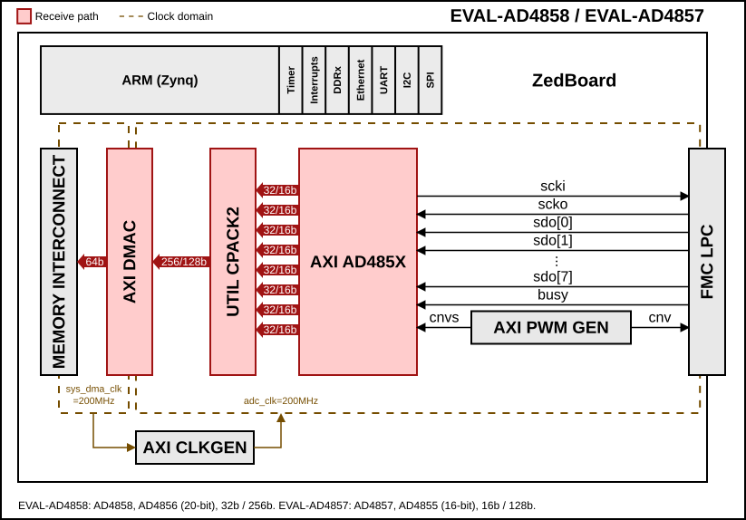
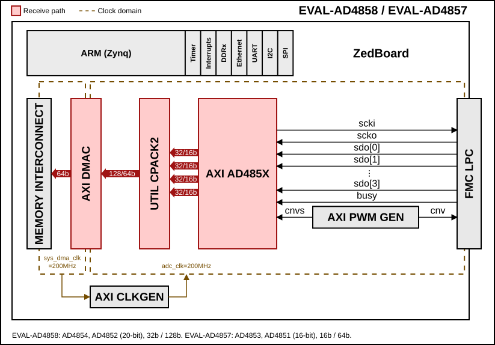
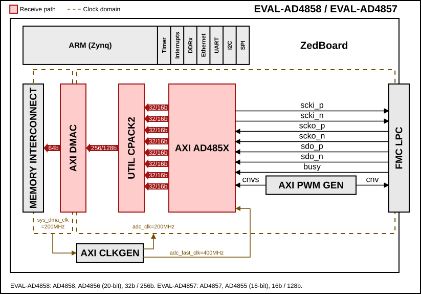
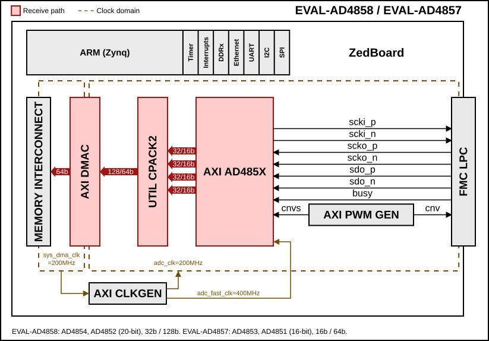
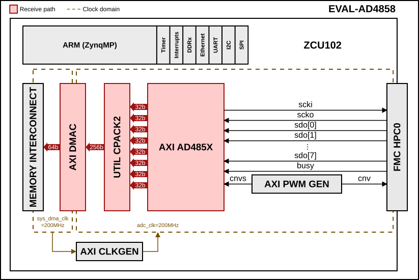
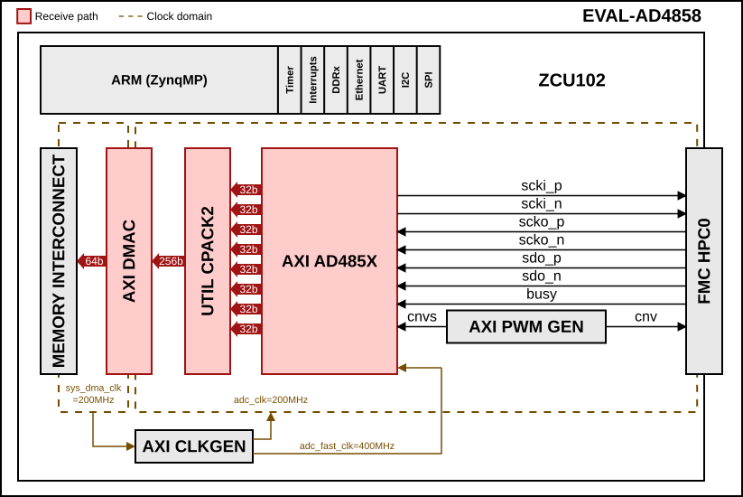
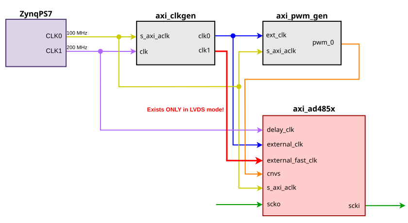
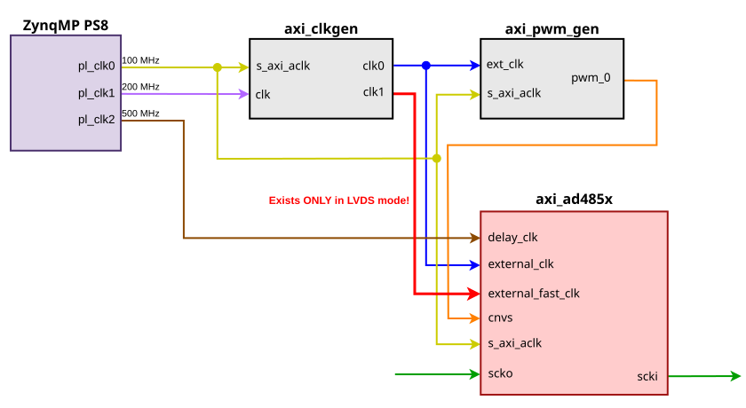

.. _ad485x_fmc:

AD485X_FMCZ HDL project
================================================================================

This design is meant to support the AD485X family. For example,
:adi:`EVAL-AD4858` board contains :adi:`AD4858` chip, which is a 20-bit, low
noise 8-channel simultaneous sampling successive approximation register (SAR)
ADC, with buffered differential, wide common range picoamp inputs.

Supported boards
-------------------------------------------------------------------------------

- :adi:`EVAL-AD4858`
- :adi:`EVAL-AD4857`

Supported devices
-------------------------------------------------------------------------------

- :adi:`AD4858`
- :adi:`AD4857`
- :adi:`AD4856`
- :adi:`AD4855`
- :adi:`AD4854`
- :adi:`AD4853`
- :adi:`AD4852`
- :adi:`AD4851`

Supported carriers
-------------------------------------------------------------------------------

+--------------------+----------+----------+
| Evaluation board   | Carrier  | FMC slot |
+====================+==========+==========+
| :adi:`EVAL-AD4858` | ZedBoard | FMC LPC  |
+--------------------+          |          |
| :adi:`EVAL-AD4857` |          |          |
+--------------------+----------+----------+
| :adi:`EVAL-AD4858` | ZCU102   | FMC HPC0 |
+--------------------+----------+----------+

Block design
-------------------------------------------------------------------------------

ZedBoard Block diagram - CMOS interface, 8 lanes
~~~~~~~~~~~~~~~~~~~~~~~~~~~~~~~~~~~~~~~~~~~~~~~~~~~~~~~~~~~~~~~~~~~~~~~~~~~~~~~

Covers the 8-lane CMOS interface (:adi:`EVAL-AD4858`: AD4858 and AD4856,
:adi:`EVAL-AD4857`: AD4857 and AD4855). This is the default configuration (``LVDS_CMOS_N=0``).

ZedBoard Block diagram - CMOS interface, 4 lanes
~~~~~~~~~~~~~~~~~~~~~~~~~~~~~~~~~~~~~~~~~~~~~~~~~~~~~~~~~~~~~~~~~~~~~~~~~~~~~~~

Covers the 4-lane CMOS interface (:adi:`EVAL-AD4858`: AD4854 and AD4852,
:adi:`EVAL-AD4857`: AD4853 and AD4851). Selected automatically for the 4-channel parts (``LVDS_CMOS_N=0`` and ``DEVICE`` set to AD4851-AD4854).

ZedBoard Block diagram - LVDS interface, 8-channel parts
~~~~~~~~~~~~~~~~~~~~~~~~~~~~~~~~~~~~~~~~~~~~~~~~~~~~~~~~~~~~~~~~~~~~~~~~~~~~~~~

Covers the LVDS interface, 8-channel parts (:adi:`EVAL-AD4858`: AD4858 and
AD4856, :adi:`EVAL-AD4857`: AD4857 and AD4855). This configuration is selected with ``LVDS_CMOS_N=1``.

ZedBoard Block diagram - LVDS interface, 4-channel parts
~~~~~~~~~~~~~~~~~~~~~~~~~~~~~~~~~~~~~~~~~~~~~~~~~~~~~~~~~~~~~~~~~~~~~~~~~~~~~~~

Covers the LVDS interface, 4-channel parts (:adi:`EVAL-AD4858`: AD4854 and
AD4852, :adi:`EVAL-AD4857`: AD4853 and AD4851). This configuration is selected with ``LVDS_CMOS_N=1`` and ``DEVICE`` set to AD4851-AD4854.

The two values in the bus widths of the ZedBoard diagrams are for the 20-bit
parts (:adi:`EVAL-AD4858`) and the 16-bit parts (:adi:`EVAL-AD4857`),
respectively. The block descriptions below apply to all
the ZedBoard diagrams.

.. collapsible:: Click here for details on the block diagram modules

   .. list-table::
      :widths: 10 20 35 35
      :header-rows: 1

      * - Block name
        - IP name
        - Documentation
        - Additional info
      * - AXI AD485X
        - :git-hdl:`axi_ad485x <library/axi_ad485x>`
        - :ref:`axi_ad485x`
        - Single instance. 8 channels (AD4855-AD4858) or 4 channels
          (AD4851-AD4854) of 32-bit (20-bit parts) or 16-bit (16-bit parts)
          samples, clocked by ``adc_clk``
      * - UTIL CPACK2
        - :git-hdl:`util_cpack2 <library/util_pack/util_cpack2>`
        - :ref:`util_cpack2`
        - Single instance, packs the channel samples into one word (256-bit or
          128-bit for 8 channels, 128-bit or 64-bit for 4 channels)
      * - AXI DMAC
        - :git-hdl:`axi_dmac <library/axi_dmac>`
        - :ref:`axi_dmac`
        - Single instance, Rx only; stream source, 64-bit memory-mapped
          destination
      * - AXI PWM GEN
        - :git-hdl:`axi_pwm_gen <library/axi_pwm_gen>`
        - :ref:`axi_pwm_gen`
        - Single instance, generates the conversion start signal ``cnvs``
      * - AXI CLKGEN
        - :git-hdl:`axi_clkgen <library/axi_clkgen>`
        - :ref:`axi_clkgen`
        - Single instance, generates ``adc_clk`` (200 MHz) and, in LVDS mode,
          ``adc_fast_clk`` (400 MHz) from ``sys_200m_clk``

AD4858_FMCZ/ZCU102 Block diagram - CMOS interface
~~~~~~~~~~~~~~~~~~~~~~~~~~~~~~~~~~~~~~~~~~~~~~~~~~~~~~~~~~~~~~~~~~~~~~~~~~~~~~~

This is the default configuration of the ZCU102 project (``LVDS_CMOS_N=0``).

AD4858_FMCZ/ZCU102 Block diagram - LVDS interface
~~~~~~~~~~~~~~~~~~~~~~~~~~~~~~~~~~~~~~~~~~~~~~~~~~~~~~~~~~~~~~~~~~~~~~~~~~~~~~~

This configuration is selected with ``LVDS_CMOS_N=1``.

The block descriptions below apply to both ZCU102 diagrams.

.. collapsible:: Click here for details on the block diagram modules

   .. list-table::
      :widths: 10 20 35 35
      :header-rows: 1

      * - Block name
        - IP name
        - Documentation
        - Additional info
      * - AXI AD485X
        - :git-hdl:`axi_ad485x <library/axi_ad485x>`
        - :ref:`axi_ad485x`
        - Single instance, 8 channels of 32-bit ``adc_data_[7:0]``, clocked by
          ``adc_clk``
      * - UTIL CPACK2
        - :git-hdl:`util_cpack2 <library/util_pack/util_cpack2>`
        - :ref:`util_cpack2`
        - Single instance, packs 8 x 32-bit samples into a 256-bit word
      * - AXI DMAC
        - :git-hdl:`axi_dmac <library/axi_dmac>`
        - :ref:`axi_dmac`
        - Single instance, Rx only; 256-bit stream source, 64-bit
          memory-mapped destination
      * - AXI PWM GEN
        - :git-hdl:`axi_pwm_gen <library/axi_pwm_gen>`
        - :ref:`axi_pwm_gen`
        - Single instance, generates the conversion start signal ``cnvs``
      * - AXI CLKGEN
        - :git-hdl:`axi_clkgen <library/axi_clkgen>`
        - :ref:`axi_clkgen`
        - Single instance, generates ``adc_clk`` (200 MHz) and, in LVDS mode,
          ``adc_fast_clk`` (400 MHz) from ``sys_200m_clk``

Clock scheme
~~~~~~~~~~~~~~~~~~~~~~~~~~~~~~~~~~~~~~~~~~~~~~~~~~~~~~~~~~~~~~~~~~~~~~~~~~~~~~~

Depending on the configuration used (CMOS or LVDS), the scheme differs a
little bit. In the sense that there is an extra clock 'external_fast_clk', see
the details in the diagrams below (one for each carrier).

For these evaluation boards, we used an internal clock of the FPGA.
Therefore, the external clocks given to AXI_AD485X IP are:

- in LVDS mode:

  - external_clk = 200 MHz
  - external_fast_clk = 400 MHz

- in CMOS mode:

  - external_clk = 200MHz

On the ZedBoard, the clocks come from ``FCLK_CLK0`` (100 MHz) and
``FCLK_CLK1`` (200 MHz) of the Zynq PS7. The ``delay_clk`` of the IDELAYCTRL
is the 200 MHz clock.

On the ZCU102, the clocks come from ``pl_clk0`` (100 MHz), ``pl_clk1``
(200 MHz) and ``pl_clk2`` (500 MHz) of the ZynqMP PS8. The ``delay_clk`` of
the IDELAYCTRL is driven by the 500 MHz ``pl_clk2``.

CPU/Memory interconnects addresses
~~~~~~~~~~~~~~~~~~~~~~~~~~~~~~~~~~~~~~~~~~~~~~~~~~~~~~~~~~~~~~~~~~~~~~~~~~~~~~~

The addresses are dependent on the architecture of the FPGA, having an offset
added to the base address from HDL(see more at :ref:`architecture cpu-intercon-addr`).

============== ===========
Instance       Zynq/ZynqMP
============== ===========
axi_ad485x     0x43C0_0000
axi_pwm_gen    0x43D0_0000
ad485x_dma     0x43E0_0000
adc_clkgen     0x4400_0000
============== ===========

SPI connections
~~~~~~~~~~~~~~~~~~~~~~~~~~~~~~~~~~~~~~~~~~~~~~~~~~~~~~~~~~~~~~~~~~~~~~~~~~~~~~~

.. list-table::
   :widths: 25 25 25 25
   :header-rows: 1

   * - SPI type
     - SPI manager instance
     - SPI subordinate
     - CS
   * - PS
     - SPI 0
     - AD485X
     - 0

Interrupts
~~~~~~~~~~~~~~~~~~~~~~~~~~~~~~~~~~~~~~~~~~~~~~~~~~~~~~~~~~~~~~~~~~~~~~~~~~~~~~~

Below are the Programmable Logic interrupts used in this project.

================ === ========== =========== ============ =============
Instance name    HDL Linux Zynq Actual Zynq Linux ZynqMP Actual ZynqMP
================ === ========== =========== ============ =============
axi_ad485x_dma   10  54         86          106          138
================ === ========== =========== ============ =============

These are the board-specific interrupts
(found in :git-hdl:`here <projects/ad485x_fmcz/common/ad485x_fmcz_bd.tcl>`).

Building the HDL project
-------------------------------------------------------------------------------

The design is built upon ADI's generic HDL reference design framework.
ADI distributes the bit/elf files of these projects as part of the
:dokuwiki:`ADI Kuiper Linux <resources/tools-software/linux-software/kuiper-linux>`.
If you want to build the sources, ADI makes them available on the
:git-hdl:`HDL repository </>`. To get the source you must
`clone <https://git-scm.com/book/en/v2/Git-Basics-Getting-a-Git-Repository>`__
the HDL repository.

Then go to the project location (**projects/ad485x_fmcz/carrier**) and run the
make command by typing in your command prompt (this example is for
`ZedBoard <https://digilent.com/shop/zedboard-zynq-7000-arm-fpga-soc-development-board>`__):

**Linux/Cygwin/WSL**

The default version of the interface is CMOS:

.. shell:: bash

   $cd hdl/projects/ad485x_fmcz/zed
   $make

To build the LVDS version of the interface, run:

.. shell:: bash

   $cd hdl/projects/ad485x_fmcz/zed
   $make LVDS_CMOS_N=1

For the `ZCU102 <https://www.xilinx.com/products/boards-and-kits/ek-u1-zcu102-g.html>`__
carrier, connect the evaluation board to the FMC HPC0 connector. The
default interface is also CMOS:

.. shell:: bash

   $cd hdl/projects/ad485x_fmcz/zcu102
   $make

To build the LVDS version of the interface, run:

.. shell:: bash

   $cd hdl/projects/ad485x_fmcz/zcu102
   $make LVDS_CMOS_N=1

A more comprehensive build guide can be found in the :ref:`build_hdl` user
guide.

Resources
-------------------------------------------------------------------------------

Systems related
~~~~~~~~~~~~~~~~~~~~~~~~~~~~~~~~~~~~~~~~~~~~~~~~~~~~~~~~~~~~~~~~~~~~~~~~~~~~~~~

Here you can find the quick start guides available for these evaluation boards:

.. list-table::
   :widths: 20 10 10
   :header-rows: 1

   * - Evaluation board
     - Zynq-7000
     - ZynqMP
   * - AD485x_FMCZ
     - :git-hdl:`zed <library/axi_ad485x>`
     - ---

HDL related
~~~~~~~~~~~~~~~~~~~~~~~~~~~~~~~~~~~~~~~~~~~~~~~~~~~~~~~~~~~~~~~~~~~~~~~~~~~~~~~

- :git-hdl:`AD485X_FMCZ HDL project source code <projects/ad485x_fmcz>`

.. list-table::
   :widths: 30 35 35
   :header-rows: 1

   * - IP name
     - Source code link
     - Documentation link
   * - AXI_AD485X
     - :git-hdl:`library/axi_ad485x`
     - :ref:`axi_ad485x`
   * - AXI_DMAC
     - :git-hdl:`library/axi_dmac`
     - :ref:`axi_dmac`
   * - AXI_CLKGEN
     - :git-hdl:`library/axi_clkgen`
     - :ref:`axi_clkgen`
   * - AXI_PWM_GEN
     - :git-hdl:`library/axi_pwm_gen`
     - :ref:`axi_pwm_gen`
   * - AXI_HDMI_TX
     - :git-hdl:`library/axi_hdmi_tx`
     - :ref:`axi_hdmi_tx`
   * - AXI_SPDIF_TX
     - :git-hdl:`library/axi_spdif_tx`
     - ---
   * - AXI_SYSID
     - :git-hdl:`library/axi_sysid`
     - :ref:`axi_sysid`
   * - SYSID_ROM
     - :git-hdl:`library/sysid_rom`
     - :ref:`axi_sysid`

Software related
~~~~~~~~~~~~~~~~~~~~~~~~~~~~~~~~~~~~~~~~~~~~~~~~~~~~~~~~~~~~~~~~~~~~~~~~~~~~~~~

.. include:: ../common/more_information.rst

.. include:: ../common/support.rst
