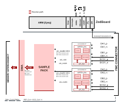
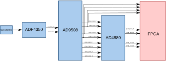

.. _ad4880_fmc_evb:

AD4880-FMC-EVB HDL project
================================================================================

.. caution::

   Although the :adi:`AD4880` supports CMOS interface, this HDL project does not
   support it. The only available interface for this project is LVDS, in DDR mode.
   Single lane mode is fully tested and supported. Dual lane mode is supported
   in the HDL but has not been tested yet.

The :adi:`EVAL-AD4880-FMC` is designed to demonstrate the :adi:`AD4880`
performance.

The :git-hdl:`AD4880-FMC-EVB HDL project <projects/ad4880_fmc_evb>` supports
the following :adi:`AD4880` , :adi:`AD4884` features:

- Single lane DDR data capture
- Self synchronization using the fixed pattern and bit-slip feature
- Capturing digital averaging filter with up to 2^10 decimation
- Analog-to-digital converter (ADC) configuration via serial peripheral
  interface (SPI)
- Sampling rate capability between 1.25 MSPS and 40 MSPS
- Capture of both channels joined word by word into one DMA stream

Supported boards
-------------------------------------------------------------------------------

- :adi:`EVAL-AD4880-FMC`
- :adi:`EVAL-AD4884-FMC`

Supported devices
-------------------------------------------------------------------------------

- :adi:`AD4880`
- :adi:`AD4884`
- :adi:`AD9508`
- :adi:`ADA4945-1`
- :adi:`ADF4350`
- :adi:`ADP7182`
- :adi:`LT6236`

Supported carriers
-------------------------------------------------------------------------------

.. list-table::
   :widths: 35 35 30
   :header-rows: 1

   * - Evaluation board
     - Carrier
     - FMC slot
   * - :adi:`EVAL-AD4880-FMC`
     - `ZedBoard <https://digilent.com/shop/zedboard-zynq-7000-arm-fpga-soc-development-board>`__
     - FMC-LPC
   * - :adi:`EVAL-AD4884-FMC`
     - `ZedBoard <https://digilent.com/shop/zedboard-zynq-7000-arm-fpga-soc-development-board>`__
     - FMC-LPC

Block design
-------------------------------------------------------------------------------

.. warning::

    The VADJ for the Zedboard must be set to 2.5V.

Block diagram
~~~~~~~~~~~~~~~~~~~~~~~~~~~~~~~~~~~~~~~~~~~~~~~~~~~~~~~~~~~~~~~~~~~~~~~~~~~~~~~

The data path and clock domains are depicted in the below diagram:

Clock scheme
~~~~~~~~~~~~~~~~~~~~~~~~~~~~~~~~~~~~~~~~~~~~~~~~~~~~~~~~~~~~~~~~~~~~~~~~~~~~~~~

Data path
~~~~~~~~~~~~~~~~~~~~~~~~~~~~~~~~~~~~~~~~~~~~~~~~~~~~~~~~~~~~~~~~~~~~~~~~~~~~~~~

Each converter has its own AXI_AD408X IP: A on axi_ad4080_adc_a, B on
axi_ad4080_adc_b. Each IP delivers one data word per adc_valid on its adc_data
output, on the clock of its own converter. The word holds one or two samples,
each sign extended: a 20-bit sample fills 32 bits, a 16-bit or 14-bit sample
16 bits, and of two samples the earlier one is in [15:0].

util_sample_pack takes the words of both IPs. Its join FIFO brings them onto
the clock of converter A and pairs them in the order they arrive: the n-th word
of A with the n-th word of B. It does not align the conversion instants of the
two converters. The design expects the clocks of the two converters, and so
their DCO clocks, to be derived from the same reference at the same
frequency; they may start at different times. On the related evaluation boards,
:adi:`EVAL-AD4880-FMC` and :adi:`EVAL-AD4884-FMC`, both come from the same
reference, on separate outputs of the :adi:`AD9508`.
Clocks from independent references would drift
apart and words would be lost now and then. The packer then writes the
samples of the enabled channels to the DMA in time order, A before B, and
skips a disabled channel. Its DMA source width is twice the adc_data width.

In this version the two data streams are started separately: the DCO clock of
each converter starts when its registers are written over its own SPI chip
select, and the bit-slip alignment of each AXI_AD408X IP also runs on its own.
So the first adc_valid can come earlier on one side than on the other, and the
samples of A and B in a pair are not guaranteed to come from the same
conversion instant. Sample-exact alignment of the two converters will be added
in a later version.

How wide the words are and how many samples they hold depends on the build:

.. list-table::
   :widths: 30 20 25 25
   :header-rows: 1

   * - Build
     - adc_data of each IP
     - Samples per word
     - DMA words, both channels
   * - ENABLE_20BIT only
     - 32 bits
     - one 20-bit sample
     - 64 bits: A B
   * - ENABLE_20BIT and ENABLE_16BIT and/or ENABLE_14BIT
     - 32 bits
     - one 20-bit sample, or two samples of an enabled 16-bit or 14-bit depth,
       each in a 16-bit slot
     - 64 bits: A B, or A0 B0 A1 B1
   * - ENABLE_14BIT on NUM_LANES=2, no ENABLE_20BIT
     - 32 bits
     - two 14-bit samples, each in a 16-bit slot; with ENABLE_16BIT also
       two 16-bit samples
     - 64 bits: A0 B0 A1 B1
   * - all other builds: ENABLE_16BIT and/or ENABLE_14BIT on NUM_LANES=1, or
       ENABLE_16BIT only on NUM_LANES=2
     - 16 bits
     - one sample of an enabled 16-bit or 14-bit depth, in a 16-bit slot
     - 32 bits: A B

In the first, third and fourth rows the sample size is fixed by the build, and
util_sample_pack moves every sample as one unit. Only the second row switches
the sample size at run time. There util_sample_pack works on 16-bit slots: a
20-bit sample takes two slots, which stay together, and a 16-bit or 14-bit
sample takes one. The size follows the DEVICE_CODE of converter A, through the
adc_sample_slots_select output of axi_ad4080_adc_a, so both converters must be
set to the same bit depth. The channel enables and the sample size are held
while a DMA transfer runs, so one buffer never mixes layouts.

The DMA words in the table hold both channels. With one channel enabled its
samples fill the DMA words in the same way, e.g. A0 A1 instead of A0 B0.

CPU/Memory interconnects addresses
~~~~~~~~~~~~~~~~~~~~~~~~~~~~~~~~~~~~~~~~~~~~~~~~~~~~~~~~~~~~~~~~~~~~~~~~~~~~~~~

The addresses are dependent on the architecture of the FPGA, having an offset
added to the base address from HDL (see more at :ref:`architecture`).

==================== ===============
Instance             Zynq/Microblaze
==================== ===============
axi_ad4080_adc_a     0x44A0_0000
axi_ad4080_adc_b     0x44A1_0000
axi_ad4880_dma       0x44A3_0000
ad4880_clock_monitor 0x44A8_0000
==================== ===============

SPI connections
~~~~~~~~~~~~~~~~~~~~~~~~~~~~~~~~~~~~~~~~~~~~~~~~~~~~~~~~~~~~~~~~~~~~~~~~~~~~~~~

.. list-table::
   :widths: 25 25 25 25
   :header-rows: 1

   * - SPI type
     - SPI manager instance
     - SPI subordinate
     - CS
   * - PS
     - SPI 0
     - AD4880_A
     - 0
   * - PS
     - SPI 0
     - AD4880_B
     - 1
   * - PS
     - SPI 1
     - AD9508
     - 0
   * - PS
     - SPI 1
     - ADF4350
     - 1

GPIOs
~~~~~~~~~~~~~~~~~~~~~~~~~~~~~~~~~~~~~~~~~~~~~~~~~~~~~~~~~~~~~~~~~~~~~~~~~~~~~~~

To know how the Software GPIO numbers are calculated, check out
:ref:`GPIOs - HDL Architecture page <architecture gpio>`.

==============  =========  =======  =========
GPIO signal     Direction  HDL no.  Zynq-7000
==============  =========  =======  =========
adcb_gpio3_fmc  OUT        39       93
adcb_gpio2_fmc  OUT        38       92
ad9508_sync     OUT        37       91
pwrgd           IN         36       90
adf435x_lock    IN         35       89
adca_gpio3_fmc  INOUT      34       88
adca_gpio2_fmc  INOUT      33       87 
==============  =========  =======  =========

.. admonition:: Legend
   :class: note

   - GPIO signal = name of the GPIO in the HDL project
   - Direction = from the FPGA point of view
   - HDL no. = HDL GPIO EMIO
   - Zynq-7000 = Software GPIO, to be used in device trees

Interrupts
~~~~~~~~~~~~~~~~~~~~~~~~~~~~~~~~~~~~~~~~~~~~~~~~~~~~~~~~~~~~~~~~~~~~~~~~~~~~~~~

Below are the Programmable Logic interrupts used in this project.

================ === ========== ===========
Instance name    HDL Linux Zynq Actual Zynq
================ === ========== ===========
axi_ad4880_dma   13  57         89
================ === ========== ===========

Building the HDL project
-------------------------------------------------------------------------------

The design is built upon ADI's generic HDL reference design framework.
ADI distributes the bit/elf files of these projects as part of the
:dokuwiki:`ADI Kuiper Linux <resources/tools-software/linux-software/kuiper-linux>`.
If you want to build the sources, ADI makes them available on the
:git-hdl:`HDL repository </>`. To get the source you must
`clone <https://git-scm.com/book/en/v2/Git-Basics-Getting-a-Git-Repository>`__
the HDL repository, and then build the project as follows:

**Linux/Cygwin/WSL**

Example of running the ``make`` command without parameters (using the default
configuration, all bit depths enabled on two lanes; a two lane build also
runs a converter set to one lane, the driver selects the lane mode at run
time):

.. shell::

   $cd hdl/projects/ad4880_fmc_evb/zed
   $make

Example of running the ``make`` command with parameters:

.. shell::

   $cd hdl/projects/ad4880_fmc_evb/zed
   $make ENABLE_20BIT=0 ENABLE_14BIT=0

The following table contains the parameters that can be used to configure this
project:

.. collapsible:: Default values of the make parameters for AD4880-FMC-EVB HDL project

   +----------------+-------------------------------------------------------------+
   | Parameter      | Description                                                 |
   +================+=============================================================+
   | NUM_LANES      | Number of LVDS data lanes per converter (default: 2)        |
   |                |                                                             |
   |                | - 1                                                         |
   |                | - 2                                                         |
   +----------------+-------------------------------------------------------------+
   | ENABLE_20BIT   | Build the 20-bit datapath (default: 1)                      |
   +----------------+-------------------------------------------------------------+
   | ENABLE_16BIT   | Build the 16-bit datapath (default: 1)                      |
   +----------------+-------------------------------------------------------------+
   | ENABLE_14BIT   | Build the 14-bit datapath (default: 1)                      |
   +----------------+-------------------------------------------------------------+

   At least one bit depth must be enabled; only the enabled depths are built.

A more comprehensive build guide can be found in the :ref:`build_hdl` user guide.

Resources
-------------------------------------------------------------------------------

Systems related
~~~~~~~~~~~~~~~~~~~~~~~~~~~~~~~~~~~~~~~~~~~~~~~~~~~~~~~~~~~~~~~~~~~~~~~~~~~~~~~

- `EVAL-AD4884 User Guide <https://www.analog.com/media/en/technical-documentation/user-guides/eval-ad4884.pdf>`__

Hardware related
~~~~~~~~~~~~~~~~~~~~~~~~~~~~~~~~~~~~~~~~~~~~~~~~~~~~~~~~~~~~~~~~~~~~~~~~~~~~~~~

-  Product datasheet: :adi:`AD4880`

HDL related
~~~~~~~~~~~~~~~~~~~~~~~~~~~~~~~~~~~~~~~~~~~~~~~~~~~~~~~~~~~~~~~~~~~~~~~~~~~~~~~

-  :git-hdl:`AD4880-FMC-EVB HDL project source code <projects/ad4880_fmc_evb>`

.. list-table::
   :widths: 30 35 35
   :header-rows: 1

   * - IP name
     - Source code link
     - Documentation link
   * - AXI_AD408X
     - :git-hdl:`library/axi_ad408x`
     - :ref:`axi_ad408x`
   * - AXI_CLKGEN
     - :git-hdl:`library/axi_clkgen`
     - :ref:`axi_clkgen`
   * - AXI_CLOCK_MONITOR
     - :git-hdl:`library/axi_clock_monitor`
     - :ref:`axi_clock_monitor`
   * - AXI_DMAC
     - :git-hdl:`library/axi_dmac`
     - :ref:`axi_dmac`
   * - AXI_HDMI_TX
     - :git-hdl:`library/axi_hdmi_tx`
     - :ref:`axi_hdmi_tx`
   * - AXI_I2S_ADI
     - :git-hdl:`library/axi_i2s_adi`
     - —
   * - AXI_SPDIF_TX
     - :git-hdl:`library/axi_spdif_tx`
     - 	—
   * - AXI_SYSID
     - :git-hdl:`library/axi_sysid`
     - :ref:`axi_sysid`
   * - SYSID_ROM
     - :git-hdl:`library/sysid_rom`
     - :ref:`axi_sysid`
   * - UTIL_I2C_MIXER
     - :git-hdl:`library/util_i2c_mixer`
     - 	—
   * - UTIL_SAMPLE_PACK
     - :git-hdl:`library/util_sample_pack`
     - —

Software related
~~~~~~~~~~~~~~~~~~~~~~~~~~~~~~~~~~~~~~~~~~~~~~~~~~~~~~~~~~~~~~~~~~~~~~~~~~~~~~~

-  Python support:

   -  `PyADI-IIO documentation <https://analogdevicesinc.github.io/pyadi-iio/>`__
   -  `PyADI-IIO example <https://github.com/analogdevicesinc/pyadi-iio/blob/ad4880/examples/ad4880_example.py>`__
   -  `PyADI-IIO class <https://github.com/analogdevicesinc/pyadi-iio/blob/ad4880/adi/ad4880.py>`__
   -  AD4880-FMC-EVB Linux device tree :git-linux:`zynq-zed-adv7511-ad4880.dts
      <arch/arm/boot/dts/zynq-zed-adv7511-ad4880.dts>`
   -  AD4880 Linux driver :git-linux:`ad4080.c <drivers/iio/adc/ad4080.c>`

.. include:: ../common/more_information.rst

.. include:: ../common/support.rst