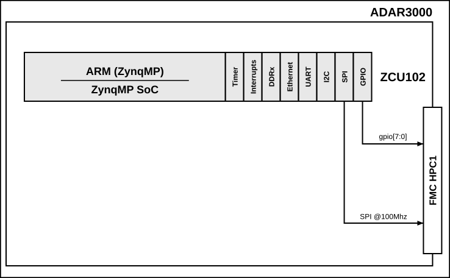

.. _adar3000:

ADAR3000 HDL project
===============================================================================

The :adi:`ADAR3000` is a 5-bit, X-band beamformer IC. It is controlled through
a SPI interface and a set of general purpose control pins.

The :adi:`EVAL-ADAR3000` evaluation board is connected to the FPGA carrier
through the :adi:`SDP-I-FMC` interposer board. The HDL project provides the
SPI and GPIO control interface of the device from the processing system (PS).

Supported boards
-------------------------------------------------------------------------------

- :adi:`EVAL-ADAR3000`

Supported devices
-------------------------------------------------------------------------------

- :adi:`ADAR3000`

Supported carriers
-------------------------------------------------------------------------------

- :xilinx:`ZCU102` on FMC HPC1 slot (VADJ = 1.8 V)

Block design
-------------------------------------------------------------------------------

Block diagram
~~~~~~~~~~~~~~~~~~~~~~~~~~~~~~~~~~~~~~~~~~~~~~~~~~~~~~~~~~~~~~~~~~~~~~~~~~~~~~~

The connections between the processing system and the device are depicted
in the below diagram:

CPU/Memory interconnects addresses
~~~~~~~~~~~~~~~~~~~~~~~~~~~~~~~~~~~~~~~~~~~~~~~~~~~~~~~~~~~~~~~~~~~~~~~~~~~~~~~

The addresses are dependent on the architecture of the FPGA, having an offset
added to the base address from HDL (see more at :ref:`architecture cpu-intercon-addr`).

============== ===========
Instance       ZynqMP
============== ===========
axi_sysid_0    0x4500_0000
============== ===========

SPI connections
~~~~~~~~~~~~~~~~~~~~~~~~~~~~~~~~~~~~~~~~~~~~~~~~~~~~~~~~~~~~~~~~~~~~~~~~~~~~~~~

.. list-table::
   :widths: 25 25 25 25
   :header-rows: 1

   * - SPI type
     - SPI manager instance
     - SPI subordinate
     - CS nb
   * - PS
     - SPI 0
     - ADAR3000
     - 0

GPIOs
~~~~~~~~~~~~~~~~~~~~~~~~~~~~~~~~~~~~~~~~~~~~~~~~~~~~~~~~~~~~~~~~~~~~~~~~~~~~~~~

To know how the Software GPIO numbers are calculated, check out
:ref:`GPIOs - HDL Architecture page <architecture gpio>`.

===========  =========  =======  ===================
GPIO signal  Direction  HDL no.  Zynq UltraScale+ MP
===========  =========  =======  ===================
gpio7        OUT        39       117
gpio6        OUT        38       116
gpio5        OUT        37       115
gpio4        OUT        36       114
gpio3        OUT        35       113
gpio2        OUT        34       112
gpio1        OUT        33       111
gpio0        OUT        32       110
===========  =========  =======  ===================

.. admonition:: Legend
   :class: note

   - GPIO signal = name of the GPIO in the HDL project
   - Direction = from the FPGA point of view
   - HDL no. = HDL GPIO EMIO
   - Zynq UltraScale+ MP is Software GPIO, to be used in
     device trees

Interrupts
~~~~~~~~~~~~~~~~~~~~~~~~~~~~~~~~~~~~~~~~~~~~~~~~~~~~~~~~~~~~~~~~~~~~~~~~~~~~~~~

This project does not use any Programmable Logic interrupts.

Building the HDL project
-------------------------------------------------------------------------------

The design is built upon ADI's generic HDL reference design framework.
If you want to build the sources, ADI makes them available on the
:git-hdl:`HDL repository </>`. To get the source you must
`clone <https://git-scm.com/book/en/v2/Git-Basics-Getting-a-Git-Repository>`__
the HDL repository, and then build the project as follows:

**Linux/Cygwin/WSL**

.. shell::

   $cd hdl/projects/adar3000/zcu102
   $make

A more comprehensive build guide can be found in the :ref:`build_hdl` user guide.

Resources
-------------------------------------------------------------------------------

Hardware related
~~~~~~~~~~~~~~~~~~~~~~~~~~~~~~~~~~~~~~~~~~~~~~~~~~~~~~~~~~~~~~~~~~~~~~~~~~~~~~~

- Product datasheets:

  - :adi:`ADAR3000`
  - :adi:`EVAL-ADAR3000`
  - :adi:`SDP-I-FMC`

HDL related
~~~~~~~~~~~~~~~~~~~~~~~~~~~~~~~~~~~~~~~~~~~~~~~~~~~~~~~~~~~~~~~~~~~~~~~~~~~~~~~

- :git-hdl:`ADAR3000 HDL project source code <projects/adar3000>`

.. list-table::
   :widths: 30 35 35
   :header-rows: 1

   * - IP name
     - Source code link
     - Documentation link
   * - AXI_SYSID
     - :git-hdl:`library/axi_sysid`
     - :ref:`axi_sysid`
   * - SYSID_ROM
     - :git-hdl:`library/sysid_rom`
     - :ref:`axi_sysid`

Software related
~~~~~~~~~~~~~~~~~~~~~~~~~~~~~~~~~~~~~~~~~~~~~~~~~~~~~~~~~~~~~~~~~~~~~~~~~~~~~~~

- :git-linux:`Linux device tree adi-adar3000-evb.dts <arch/arm64/boot/dts/xilinx/adi-adar3000-evb.dts>`

.. include:: ../common/more_information.rst

.. include:: ../common/support.rst
