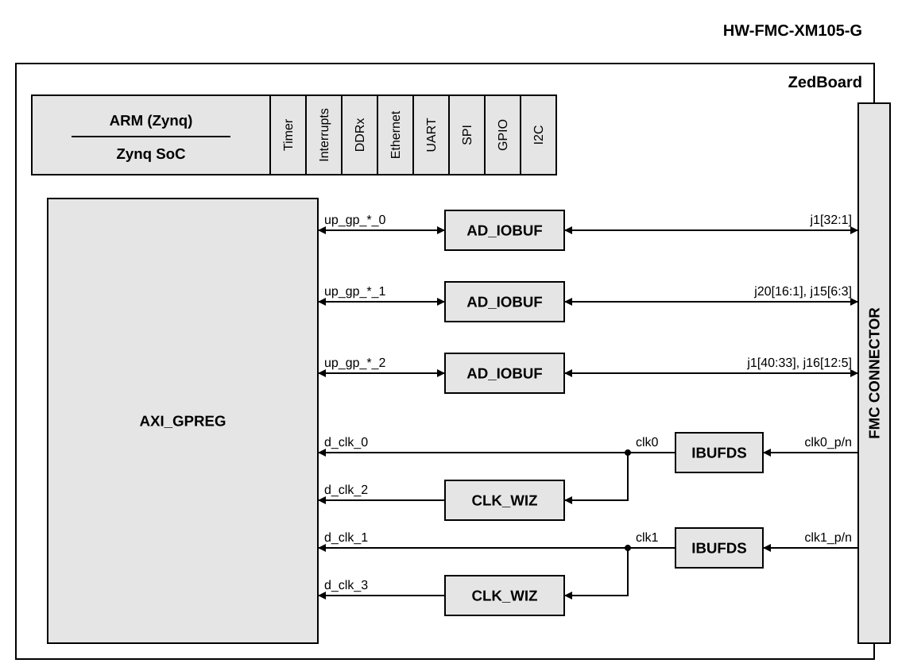

.. _fmc_xm105:

FMC-XM105 HDL project
===============================================================================

The `HW-FMC-XM105-G <https://www.amd.com/en/products/adaptive-socs-and-fpgas/evaluation-boards/hw-fmc-xm105-g.html>`__
is an AMD FMC debug card. It breaks out the user signals of an FMC LPC
connector to 0.1" pin headers, and it provides a programmable Si570 clock
source and a pair of SMA connectors for the FMC clock inputs.

The **fmc_xm105** project makes the header pins of the card accessible from
software. Every constrained header pin is connected to a bidirectional buffer
controlled by an :git-hdl:`axi_gpreg <library/axi_gpreg>` instance, so the
direction, the output value and the input value of each pin can be set and
read through memory-mapped registers. The same instance monitors the two FMC
clocks coming from the card, and an ILA records all the GPIO signals for
debugging in Vivado.

Supported boards
-------------------------------------------------------------------------------

- `HW-FMC-XM105-G <https://www.amd.com/en/products/adaptive-socs-and-fpgas/evaluation-boards/hw-fmc-xm105-g.html>`__

Supported devices
-------------------------------------------------------------------------------

- None.

Supported carriers
-------------------------------------------------------------------------------

.. list-table::
   :widths: 35 35 30
   :header-rows: 1

   * - Evaluation board
     - Carrier
     - FMC slot
   * - HW-FMC-XM105-G
     - `ZedBoard <https://digilent.com/shop/zedboard-zynq-7000-arm-fpga-soc-development-board>`__
     - FMC LPC

All the header pins are constrained as LVCMOS25, and the clock inputs as
LVDS_25, so the VADJ of the carrier must be set to 2.5 V.

Block design
-------------------------------------------------------------------------------

Block diagram
~~~~~~~~~~~~~~~~~~~~~~~~~~~~~~~~~~~~~~~~~~~~~~~~~~~~~~~~~~~~~~~~~~~~~~~~~~~~~~~

.. collapsible:: Click here for details on the block diagram modules

   .. list-table::
      :widths: 10 20 35 35
      :header-rows: 1

      * - Block name
        - IP name
        - Documentation
        - Additional info
      * - AD_IOBUF
        - :git-hdl:`ad_iobuf <library/common/ad_iobuf.v>`
        - ---
        - 3 instances in ``system_top.v``: ``i_iobuf_1`` (32 bits, bank 0 ↔ j1[32:1]), ``i_iobuf_2`` (20 bits, bank 1[19:0] ↔ {j20[16:1], j15[6:3]}), ``i_iobuf_3`` (16 bits, bank 2[15:0] ↔ {j1[40:33], j16[12:5]}); unused bank bits read as 0
      * - ARM (Zynq)
        - processing_system7 (AMD)
        - ---
        - Instance ``sys_ps7``; FCLK_CLK0 = 100 MHz (sys_cpu_clk) clocks the AXI_GPREG register interface
      * - AXI_GPREG
        - :git-hdl:`axi_gpreg <library/axi_gpreg>`
        - ---
        - Instance ``axi_gpreg``; NUM_OF_IO = 3 (GPIO banks 0..2: up_gp_ioenb_n / up_gp_out_n / up_gp_in_n, 32 bits each), NUM_OF_CLK_MONS = 4 (d_clk_0 = clk0, d_clk_1 = clk1, d_clk_2 = clk_wiz_0 output, d_clk_3 = clk_wiz_1 output); s_axi_aclk = sys_cpu_clk
      * - CLK_WIZ
        - clk_wiz (AMD)
        - ---
        - 2 instances: ``clk_wiz_0`` (input clk0), ``clk_wiz_1`` (input clk1); CLKOUT1_REQUESTED_OUT_FREQ = 20 MHz for the default 100 MHz input; no buffer, no locked, no reset
      * - IBUFDS
        - IBUFDS (AMD primitive)
        - ---
        - 2 instances in ``system_top.v``: ``i_clk0`` (clk0_p/n → clk0), ``i_clk1`` (clk1_p/n → clk1); LVDS_25

Clock scheme
~~~~~~~~~~~~~~~~~~~~~~~~~~~~~~~~~~~~~~~~~~~~~~~~~~~~~~~~~~~~~~~~~~~~~~~~~~~~~~~

The two FMC clock inputs from the card are buffered by ``IBUFDS`` primitives in
``system_top.v`` and brought into the block design as ``clk0`` and ``clk1``.
Each clock goes directly to a clock monitor of ``axi_gpreg``, and also through
a clock wizard whose output goes to a second clock monitor.

.. list-table::
   :widths: 20 30 50
   :header-rows: 1

   * - Clock
     - Source
     - Used by
   * - ``clk0``
     - CLK0_M2C, Si570 (U2) on the card
     - ``axi_gpreg`` clock monitor 0, ``clk_wiz_0`` input
   * - ``clk1``
     - CLK1_M2C, SMA connectors J9 (P) and J10 (N) on the card
     - ``axi_gpreg`` clock monitor 1, ``clk_wiz_1`` input
   * - ``clk_wiz_0/clk_out1``
     - ``clk0``, requested output of 20 MHz
     - ``axi_gpreg`` clock monitor 2
   * - ``clk_wiz_1/clk_out1``
     - ``clk1``, requested output of 20 MHz
     - ``axi_gpreg`` clock monitor 3
   * - ``sys_cpu_clk``
     - PS FCLK_CLK0, 100 MHz
     - AXI interconnect, ``axi_gpreg`` register interface, ILA

The clock wizards keep their default input frequency of 100 MHz, so the
20 MHz output is valid only when the corresponding input clock is 100 MHz.

A clock monitor counts the cycles of its clock during 65536 cycles of
``sys_cpu_clk``, so the frequency of the monitored clock is
COUNT × 100 MHz / 65536.

CPU/Memory interconnects addresses
~~~~~~~~~~~~~~~~~~~~~~~~~~~~~~~~~~~~~~~~~~~~~~~~~~~~~~~~~~~~~~~~~~~~~~~~~~~~~~~

The addresses are dependent on the architecture of the FPGA, having an offset
added to the base address from HDL (see more at :ref:`architecture cpu-intercon-addr`).

==================== ===========
Instance             Zynq
==================== ===========
axi_gpreg            0x7902_0000
==================== ===========

The ``axi_gpreg`` instance is configured with 3 GPIO banks
(``NUM_OF_IO = 3``) and 4 clock monitors (``NUM_OF_CLK_MONS = 4``). Its
registers, as offsets from the base address, are:

.. list-table::
   :widths: 20 20 60
   :header-rows: 1

   * - Offset
     - Register
     - Description
   * - 0x000
     - VERSION
     - IP version (0x0004_0063)
   * - 0x400 + 0x40 × n
     - IOENB
     - GPIO bank n direction, 1 = input, 0 = output (resets to all inputs)
   * - 0x404 + 0x40 × n
     - OUT
     - GPIO bank n output value
   * - 0x408 + 0x40 × n
     - IN
     - GPIO bank n input value
   * - 0x800 + 0x40 × m
     - RESETN
     - Clock monitor m, write 1 to enable the counter
   * - 0x808 + 0x40 × m
     - COUNT
     - Clock monitor m, clock count value

GPIOs
~~~~~~~~~~~~~~~~~~~~~~~~~~~~~~~~~~~~~~~~~~~~~~~~~~~~~~~~~~~~~~~~~~~~~~~~~~~~~~~

The header pins of the card are mapped to the ``axi_gpreg`` GPIO banks as
follows. The unused bits of a bank read as 0.

.. list-table::
   :widths: 20 30 50
   :header-rows: 1

   * - Bank
     - Register bits
     - Header pins
   * - 0
     - [31:0]
     - J1[32:1]
   * - 1
     - [19:4]
     - J20[16:1]
   * - 1
     - [3:0]
     - J15[6:3]
   * - 2
     - [15:8]
     - J1[40:33]
   * - 2
     - [7:0]
     - J16[12:5]

The PS EMIO GPIOs are used as in the ZedBoard base design; bits 32 to 63 are
looped back from ``gpio_o`` to ``gpio_i``.

ILA
~~~~~~~~~~~~~~~~~~~~~~~~~~~~~~~~~~~~~~~~~~~~~~~~~~~~~~~~~~~~~~~~~~~~~~~~~~~~~~~

The design contains an ILA (``my_ila``) clocked by ``sys_cpu_clk``, with a
data depth of 4096 samples and nine 32-bit probes:

.. list-table::
   :widths: 20 80
   :header-rows: 1

   * - Probes
     - Signals
   * - probe0 to probe2
     - ``gp_in_0`` to ``gp_in_2``
   * - probe3 to probe5
     - ``gp_out_0`` to ``gp_out_2``
   * - probe6 to probe8
     - ``gp_t_0`` to ``gp_t_2``

Interrupts
~~~~~~~~~~~~~~~~~~~~~~~~~~~~~~~~~~~~~~~~~~~~~~~~~~~~~~~~~~~~~~~~~~~~~~~~~~~~~~~

This project does not add any interrupts to the ZedBoard base design.

Building the HDL project
-------------------------------------------------------------------------------

The design is built upon ADI's generic HDL reference design framework. ADI makes
the sources available on the :git-hdl:`HDL repository </>`. To get the source
you must
`clone <https://git-scm.com/book/en/v2/Git-Basics-Getting-a-Git-Repository>`__
the HDL repository, and then build the project as follows:

**Linux/Cygwin/WSL**

.. shell::

   $cd hdl/projects/fmc_xm105/zed
   $make

A more comprehensive build guide can be found in the :ref:`build_hdl` user guide.

Resources
-------------------------------------------------------------------------------

Hardware related
~~~~~~~~~~~~~~~~~~~~~~~~~~~~~~~~~~~~~~~~~~~~~~~~~~~~~~~~~~~~~~~~~~~~~~~~~~~~~~~

- `HW-FMC-XM105-G product page <https://www.amd.com/en/products/adaptive-socs-and-fpgas/evaluation-boards/hw-fmc-xm105-g.html>`__

HDL related
~~~~~~~~~~~~~~~~~~~~~~~~~~~~~~~~~~~~~~~~~~~~~~~~~~~~~~~~~~~~~~~~~~~~~~~~~~~~~~~

- :git-hdl:`FMC-XM105 HDL project source code <projects/fmc_xm105>`

.. list-table::
   :widths: 30 35 35
   :header-rows: 1

   * - IP name
     - Source code link
     - Documentation link
   * - AXI_GPREG
     - :git-hdl:`library/axi_gpreg`
     - ---
   * - AXI_CLKGEN
     - :git-hdl:`library/axi_clkgen`
     - :ref:`axi_clkgen`
   * - AXI_HDMI_TX
     - :git-hdl:`library/axi_hdmi_tx`
     - :ref:`axi_hdmi_tx`
   * - AXI_DMAC
     - :git-hdl:`library/axi_dmac`
     - :ref:`axi_dmac`
   * - AXI_SPDIF_TX
     - :git-hdl:`library/axi_spdif_tx`
     - ---
   * - AXI_I2S_ADI
     - :git-hdl:`library/axi_i2s_adi`
     - ---
   * - AXI_SYSID
     - :git-hdl:`library/axi_sysid`
     - :ref:`axi_sysid`
   * - SYSID_ROM
     - :git-hdl:`library/sysid_rom`
     - :ref:`axi_sysid`
   * - UTIL_I2C_MIXER
     - :git-hdl:`library/util_i2c_mixer`
     - ---

Besides the ADI IPs above, the design uses the AMD ``clk_wiz`` and ``ila``
LogiCORE IPs, delivered with Vivado.

Software related
~~~~~~~~~~~~~~~~~~~~~~~~~~~~~~~~~~~~~~~~~~~~~~~~~~~~~~~~~~~~~~~~~~~~~~~~~~~~~~~

The ``axi_gpreg`` registers (see the register map and the GPIO bank mapping
above) can be accessed with ``busybox devmem`` on the ZedBoard. For example,
to read the ``axi_gpreg`` version, drive the J1[32:1] pins (GPIO bank 0) with a
pattern, and read clock monitor 0 (``clk0``):

.. shell::

   $busybox devmem 0x79020000
    0x00040063
   $busybox devmem 0x79020400 32 0x00000000
   $busybox devmem 0x79020404 32 0xAAAAAAAA
   $busybox devmem 0x79020800 32 1
   $busybox devmem 0x79020808

Writing 0 to the bank 0 IOENB register (``0x79020400``) sets all its pins as
outputs, and ``0x79020404`` sets their values. Writing 1 to the RESETN
register of clock monitor 0 (``0x79020800``) enables its counter, and the value
read from its COUNT register (``0x79020808``) gives the frequency of ``clk0`` as
COUNT × 100 MHz / 65536.

Python scripts that test the header pins of the card with an
:adi:`ADALM2000 <ADALM2000>` are available in
:git-pyadi-iio:`examples/fmc_xm105 <examples/fmc_xm105>`; their README
describes the setup and the tests.

.. include:: ../common/more_information.rst

.. include:: ../common/support.rst
