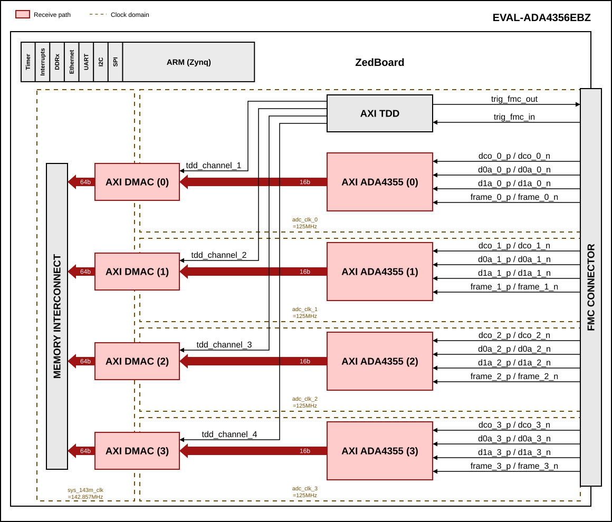
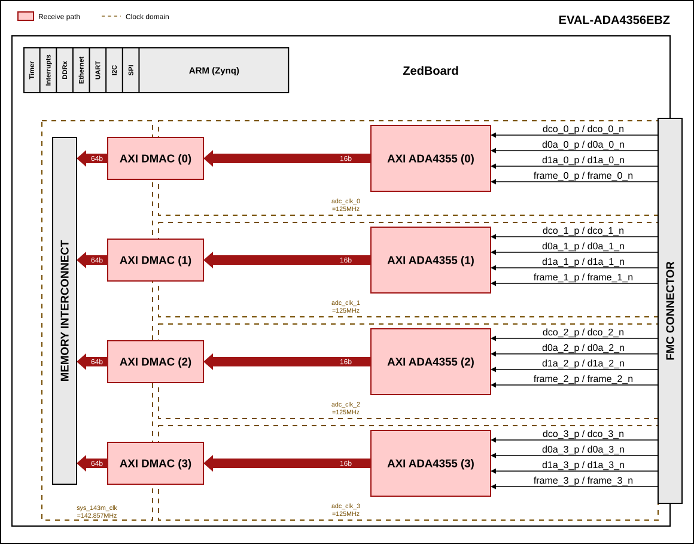

.. _quad_ada4356:

QUAD-ADA4356 HDL project
================================================================================

Overview
-------------------------------------------------------------------------------

The EVAL-ADA4356EBZ carries four :adi:`ADA4356` current-input µModule
receivers and an :adi:`AD9517-4` clock generator on one FMC board. Each
:adi:`ADA4356` combines a programmable transimpedance amplifier, a low-pass
filter selectable between 100 MHz and 1 MHz and a 14-bit, 125 MSPS ADC, and
outputs its samples over two LVDS data lanes, a frame clock (FCO) and a
500 MHz DDR data clock (DCO).

The HDL design captures the four ADCs in parallel. Each :adi:`ADA4356` has its
own :ref:`AXI ADA4355 <axi_ada4355>` core and its own :ref:`axi_dmac`, so each
channel is captured in its own DCO clock domain and written to memory
independently. The :adi:`AD9517-4` supplies a separate sample clock to each
:adi:`ADA4356`.

In the default configuration an :ref:`axi_tdd` controller generates the
external trigger output and starts the four DMA transfers, for triggered
(LiDAR-style) acquisition. See `Configuration modes`_.

Supported boards
-------------------------------------------------------------------------------

- EVAL-ADA4356EBZ

Supported devices
-------------------------------------------------------------------------------

- :adi:`ADA4356`
- :adi:`AD9517-4`

Supported carriers
-------------------------------------------------------------------------------

.. list-table::
   :widths: 35 35 30
   :header-rows: 1

   * - Evaluation board
     - Carrier
     - FMC slot
   * - EVAL-ADA4356EBZ
     - `ZedBoard <https://digilent.com/shop/zedboard-zynq-7000-arm-fpga-soc-development-board>`__
     - FMC LPC

Block design
-------------------------------------------------------------------------------

.. warning::

   The VADJ for the ZedBoard must be set to 2.5 V.

Block diagram - TDD_SUPPORT=1
~~~~~~~~~~~~~~~~~~~~~~~~~~~~~~~~~~~~~~~~~~~~~~~~~~~~~~~~~~~~~~~~~~~~~~~~~~~~~~~

The data path and clock domains of the default configuration are depicted in
the below diagram:

Block diagram - TDD_SUPPORT=0
~~~~~~~~~~~~~~~~~~~~~~~~~~~~~~~~~~~~~~~~~~~~~~~~~~~~~~~~~~~~~~~~~~~~~~~~~~~~~~~

Without the TDD controller, each DMA transfer starts as soon as software
submits it:

The following table applies to both diagrams.

.. collapsible:: Click here for details on the block diagram modules

   .. list-table::
      :widths: 10 20 35 35
      :header-rows: 1

      * - Block name
        - IP name
        - Documentation
        - Additional info
      * - AXI ADA4355
        - :git-hdl:`axi_ada4355 <library/axi_ada4355>`
        - :ref:`axi_ada4355`
        - 4 instances, ``axi_ada4355_adc_0`` ... ``axi_ada4355_adc_3``, one per
          :adi:`ADA4356`. Each deserializes its two LVDS lanes and frame clock
          1:8 on its own DCO (500 MHz DDR), divided by 4 to its ``adc_clk``
          (125 MHz), and outputs 16-bit ``adc_data``. ``IODELAY_CTRL`` is 1 on
          instances 0 and 2 only, one IDELAYCTRL per IO bank
          (``IO_DELAY_GROUP`` ``adc_if_delay_group_0`` for bank 34,
          ``adc_if_delay_group_1`` for bank 35); ``delay_clk`` is
          ``sys_200m_clk``.
      * - AXI DMAC
        - :git-hdl:`axi_dmac <library/axi_dmac>`
        - :ref:`axi_dmac`
        - 4 instances, ``axi_ada4355_dma_0`` ... ``axi_ada4355_dma_3``. FIFO
          write source, 16-bit, on the ``adc_clk`` of its AXI ADA4355;
          AXI-MM destination, 64-bit, on ``sys_143m_clk``. ``CYCLIC`` = 0;
          ``SYNC_TRANSFER_START`` = ``TDD_SUPPORT``.
      * - AXI TDD
        - :git-hdl:`axi_tdd <library/axi_tdd>`
        - :ref:`axi_tdd`
        - ``TDD_SUPPORT=1`` only. Single instance, ``axi_tdd_0``, with 5
          channels, clocked by the ``adc_clk`` of ``axi_ada4355_adc_0``.
          ``tdd_channel_0`` drives ``trig_fmc_out``; ``tdd_channel_1`` ...
          ``tdd_channel_4`` drive the ``sync`` input of DMA 0 ... 3;
          ``sync_in`` is ``trig_fmc_in``. Created by ``ad_tdd_gen_create``.
      * - MEMORY INTERCONNECT
        - ``axi_hp1_interconnect`` (AMD AXI Interconnect)
        - ---
        - Created by ``ad_mem_hp1_interconnect``. Four 64-bit slave ports, one
          per DMA, and one master to the PS ``S_AXI_HP1`` port, all on
          ``sys_143m_clk``.

Clock scheme
~~~~~~~~~~~~~~~~~~~~~~~~~~~~~~~~~~~~~~~~~~~~~~~~~~~~~~~~~~~~~~~~~~~~~~~~~~~~~~~

- Each :adi:`ADA4356` receives its own sample clock from the :adi:`AD9517-4`
  and sources its own DCO (500 MHz). Each AXI ADA4355 divides its DCO by 4
  to its ``adc_clk`` (125 MHz), so the design has four ``adc_clk`` domains of
  the same frequency but independent phase.
- ``sys_143m_clk`` (PS ``FCLK_CLK2``) is the DMA clock. 142.8 MHz is requested,
  the PS delivers 1000/7 = 142.857 MHz.
- ``sys_200m_clk`` (PS ``FCLK_CLK1``) is the IDELAYCTRL reference clock.
- ``sys_cpu_clk`` (PS ``FCLK_CLK0``, 100 MHz) clocks the AXI-Lite register
  interfaces.

Limitations
~~~~~~~~~~~~~~~~~~~~~~~~~~~~~~~~~~~~~~~~~~~~~~~~~~~~~~~~~~~~~~~~~~~~~~~~~~~~~~~

- The four DMAs share the 64-bit ``S_AXI_HP1`` port. At 142.857 MHz it carries
  1143 MB/s, for a demand of 4 x 125 MSPS x 2 B = 1000 MB/s, so there is only
  14% margin: adding channels or raising the sample rate needs the DMAs to be
  split across more HP ports.
- The four ``adc_clk`` domains are independent, so the channels are not
  sample-aligned in hardware. With ``TDD_SUPPORT=1``, ``axi_tdd_0`` runs on
  the ``adc_clk`` of ``axi_ada4355_adc_0`` and its ``sync`` outputs reach DMAs
  1 ... 3 without a synchronizer, so their transfers can start one sample
  apart from DMA 0. The inter-channel offset is measured and removed in
  software.

Configuration modes
~~~~~~~~~~~~~~~~~~~~~~~~~~~~~~~~~~~~~~~~~~~~~~~~~~~~~~~~~~~~~~~~~~~~~~~~~~~~~~~

The TDD_SUPPORT configuration parameter selects how the four DMA transfers
are started. It is set at build time, because ``SYNC_TRANSFER_START`` of
:ref:`axi_dmac` cannot be changed at runtime:

- 1 - (default) an ``axi_tdd`` controller drives ``trig_fmc_out`` and starts
  the four DMAs. Each submitted transfer waits for its TDD channel to pulse,
  so one buffer is captured per trigger.
- 0 - no ``axi_tdd``. Each DMA transfer starts as soon as software submits it.
  ``trig_fmc_out`` is tied low and ``trig_fmc_in`` is unused.

Neither mode is cyclic: one transfer is one buffer.

CPU/Memory interconnects addresses
~~~~~~~~~~~~~~~~~~~~~~~~~~~~~~~~~~~~~~~~~~~~~~~~~~~~~~~~~~~~~~~~~~~~~~~~~~~~~~~

The addresses are dependent on the architecture of the FPGA, having an offset
added to the base address from HDL (see more at :ref:`architecture cpu-intercon-addr`).

Depending on the value of parameter $TDD_SUPPORT, some IPs are instantiated
and some are not.

Check-out the table below to find out the conditions.

==================== =========================== ===============
Instance             Depends on parameter        Zynq/Microblaze
==================== =========================== ===============
axi_ada4355_adc_0                                0x44A0_0000
axi_ada4355_adc_1                                0x44A1_0000
axi_ada4355_adc_2                                0x44A2_0000
axi_ada4355_adc_3                                0x44A3_0000
axi_ada4355_dma_0                                0x44A4_0000
axi_ada4355_dma_1                                0x44A5_0000
axi_ada4355_dma_2                                0x44A6_0000
axi_ada4355_dma_3                                0x44A7_0000
axi_tdd_0            $TDD_SUPPORT==1             0x44A8_0000
==================== =========================== ===============

I2C connections
~~~~~~~~~~~~~~~~~~~~~~~~~~~~~~~~~~~~~~~~~~~~~~~~~~~~~~~~~~~~~~~~~~~~~~~~~~~~~~~

.. list-table::
   :widths: 20 20 20 20 20
   :header-rows: 1

   * - I2C type
     - I2C manager instance
     - Alias
     - Address
     - I2C subordinate
   * - PL
     - iic_fmc
     - axi_iic_fmc
     - 0x4162_0000
     - 3 x MAX7320 (0x59, 0x5D, 0x5E), AD7291 (0x2F)
   * - PL
     - iic_main
     - axi_iic_main
     - 0x4160_0000
     - ---

The MAX7320 output expanders drive the per-channel gain (GSEL) and filter
(FREQ_SEL) selects and the current-divider enables. They are on the FMC I2C
bus, not on FPGA GPIOs.

SPI connections
~~~~~~~~~~~~~~~~~~~~~~~~~~~~~~~~~~~~~~~~~~~~~~~~~~~~~~~~~~~~~~~~~~~~~~~~~~~~~~~

The PS SPI 0 hard chip selects are not routed to the FMC; its five chip
selects are GPIOs (see `GPIOs`_).

.. list-table::
   :widths: 25 25 25 25
   :header-rows: 1

   * - SPI type
     - SPI manager instance
     - SPI subordinate
     - CS
   * - PS
     - SPI 0
     - ADA4356 (A, B, C, D)
     - GPIO ``csb_duta`` ... ``csb_dutd``
   * - PS
     - SPI 0
     - AD9517-4
     - GPIO ``csb_ad9510``
   * - PS
     - SPI 1
     - APD bias digital potentiometer
     - 0 (``csb_apd_pot``)

GPIOs
~~~~~~~~~~~~~~~~~~~~~~~~~~~~~~~~~~~~~~~~~~~~~~~~~~~~~~~~~~~~~~~~~~~~~~~~~~~~~~~

The Software GPIO number is calculated as follows:

- Zynq-7000: if PS7 is used, then offset is 54

.. list-table::
   :widths: 25 20 15 15 25
   :header-rows: 2

   * - GPIO signal
     - Direction
     - HDL GPIO EMIO
     - Software GPIO
     - Description
   * -
     - (from FPGA view)
     -
     - Zynq-7000
     -
   * - apd_supp_en
     - INOUT
     - 37
     - 91
     - APD supply enable
   * - csb_ad9510
     - INOUT
     - 36
     - 90
     - AD9517-4 SPI chip select, active low
   * - csb_dutd
     - INOUT
     - 35
     - 89
     - ADA4356 D SPI chip select, active low
   * - csb_dutc
     - INOUT
     - 34
     - 88
     - ADA4356 C SPI chip select, active low
   * - csb_dutb
     - INOUT
     - 33
     - 87
     - ADA4356 B SPI chip select, active low
   * - csb_duta
     - INOUT
     - 32
     - 86
     - ADA4356 A SPI chip select, active low

``csb_ad9510`` is the schematic net name; the device is an :adi:`AD9517-4`.
``trig_fmc_in`` and ``trig_fmc_out`` are not GPIOs; they connect to
``axi_tdd_0``.

Interrupts
~~~~~~~~~~~~~~~~~~~~~~~~~~~~~~~~~~~~~~~~~~~~~~~~~~~~~~~~~~~~~~~~~~~~~~~~~~~~~~~

Below are the Programmable Logic interrupts used in this project.

================= === ========== ===========
Instance name     HDL Linux Zynq Actual Zynq
================= === ========== ===========
axi_ada4355_dma_3 13  57         89
axi_ada4355_dma_2 12  56         88
axi_ada4355_dma_1 10  54         86
axi_ada4355_dma_0 9   53         85
================= === ========== ===========

Interrupts 11, 14 and 15 are already used by the ZedBoard base design
(``axi_iic_fmc``, ``axi_iic_main`` and ``axi_hdmi_dma``).

Building the HDL project
-------------------------------------------------------------------------------

The design is built upon ADI's generic HDL reference design framework.
ADI distributes the bit/elf files of these projects as part of the
:dokuwiki:`ADI Kuiper Linux <resources/tools-software/linux-software/kuiper-linux>`.
If you want to build the sources, ADI makes them available on the
:git-hdl:`HDL repository </>`. To get the source you must
`clone <https://git-scm.com/book/en/v2/Git-Basics-Getting-a-Git-Repository>`__
the HDL repository.

**Linux/Cygwin/WSL**

Example for building with the default configuration (TDD_SUPPORT=1):

.. shell::

   $cd hdl/projects/quad_ada4356/zed
   $make TDD_SUPPORT=1

Example for building without the TDD controller:

.. shell::

   ~/hdl/projects/quad_ada4356/zed
   $make TDD_SUPPORT=0

The result of the build, if parameters were used, will be in a folder named
by the configuration used. If the following command was run

``make TDD_SUPPORT=0``

then the folder name will be: ``TDDSUPPORT0``.

A plain ``make`` builds the default configuration, but in the ``zed`` folder
itself, because the folder name comes only from the parameters given on the
command line.

Check `Configuration modes`_ for more details.

A more comprehensive build guide can be found in the :ref:`build_hdl` user guide.
To create the boot image, see :ref:`build_boot_bin`.

Software considerations
-------------------------------------------------------------------------------

- Each AXI ADA4355 holds its BUFR divider and its ISERDES in reset from FPGA
  configuration until software sets ``ADI_REG_RSTN`` bit 1 (``MMCM_RSTN``),
  after the :adi:`AD9517-4` is locked. The standard AXI ADC probe sequence
  does this; other software must set ``ADI_REG_RSTN`` to 0x3 before reading
  data. See :ref:`axi_ada4355`.
- With ``TDD_SUPPORT=1``, all four DMA transfers must be submitted before
  ``axi_tdd_0`` fires, and its ``sync_start_enable`` must be armed, or no
  transfer starts.
- The four channels have independent clock domains, so the whole-sample offset
  between them changes from boot to boot. Measure and remove it in software
  after every boot, and again after changing the gain or filter mode.

Resources
-------------------------------------------------------------------------------

Hardware related
~~~~~~~~~~~~~~~~~~~~~~~~~~~~~~~~~~~~~~~~~~~~~~~~~~~~~~~~~~~~~~~~~~~~~~~~~~~~~~~

- Product datasheets:

  - :adi:`ADA4356`
  - :adi:`AD9517-4`

HDL related
~~~~~~~~~~~~~~~~~~~~~~~~~~~~~~~~~~~~~~~~~~~~~~~~~~~~~~~~~~~~~~~~~~~~~~~~~~~~~~~

- :git-hdl:`QUAD-ADA4356 HDL project source code <projects/quad_ada4356>`

.. list-table::
   :widths: 30 35 35
   :header-rows: 1

   * - IP name
     - Source code link
     - Documentation link
   * - AXI_ADA4355
     - :git-hdl:`library/axi_ada4355`
     - :ref:`axi_ada4355`
   * - AXI_CLKGEN
     - :git-hdl:`library/axi_clkgen`
     - :ref:`axi_clkgen`
   * - AXI_DMAC
     - :git-hdl:`library/axi_dmac`
     - :ref:`axi_dmac`
   * - AXI_HDMI_TX
     - :git-hdl:`library/axi_hdmi_tx`
     - :ref:`axi_hdmi_tx`
   * - AXI_I2S_ADI
     - :git-hdl:`library/axi_i2s_adi`
     - ---
   * - AXI_SPDIF_TX
     - :git-hdl:`library/axi_spdif_tx`
     - ---
   * - AXI_SYSID
     - :git-hdl:`library/axi_sysid`
     - :ref:`axi_sysid`
   * - AXI_TDD
     - :git-hdl:`library/axi_tdd`
     - :ref:`axi_tdd`
   * - SYSID_ROM
     - :git-hdl:`library/sysid_rom`
     - :ref:`axi_sysid`
   * - UTIL_I2C_MIXER
     - :git-hdl:`library/util_i2c_mixer`
     - ---

Software related
~~~~~~~~~~~~~~~~~~~~~~~~~~~~~~~~~~~~~~~~~~~~~~~~~~~~~~~~~~~~~~~~~~~~~~~~~~~~~~~

- :git-linux:`AD9517-4 Linux driver <drivers/iio/frequency/ad9517.c>`

.. include:: ../common/more_information.rst

.. include:: ../common/support.rst
